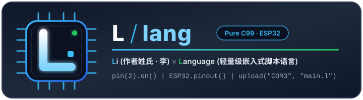
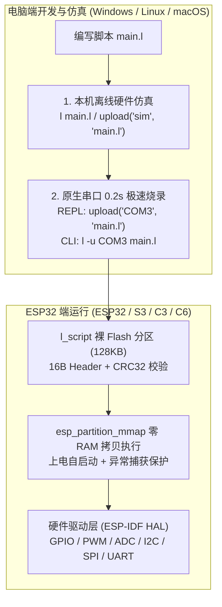

<div align="center">



# L 语言 (`lang`)

**一门用纯 C99 从零实现的超轻量级嵌入式（ESP32）与通用脚本语言**

[](version.h)
[](main.c)
[](l_hal.h)
[](esp32/)
[](tests/)

[设计理念与命名](#命名由来为什么叫-l-lang) ·
[核心能力](#这是什么能做什么) ·
[快速开始](#快速开始) ·
[详细使用教程](#详细使用教程) ·
[ESP32 固件编译与刷机](#esp32-固件编译与刷机详细步骤) ·
[《ESP32 固件编译与刷机指南》](esp32/ESP32_GUIDE.md)

</div>

---

## 命名由来：为什么叫 `L` (`lang`)？

项目的核心命令与文件后缀均为 **`l`**（仓库名 **`lang`**），字母 **`L`** 承载着两层核心含义：

1. **`L` = Li（李 · 作者姓氏）**  
   源自项目作者姓氏（**Yongyao Li**）。从词法分析器、递归下降语法分析器、AST、标记-清除垃圾回收器（GC）、硬件抽象层（HAL）到 ESP32 裸机固件，每一行代码均由纯 C 手写而成，凝聚着对底层系统与语言设计的个人匠心。
2. **`L` = Lang（`Language` · 编程语言的缩写）**  
   取自 **Language**（同时也寓意 **Lightweight** 轻量级）的缩写。它回归编程语言最纯粹的本质——**零第三方依赖、百余 KB 体积、一行命令即可编译、一句 `pin(2).on()` 即可点亮硬件**。

---

## 这是什么？能做什么？

### 1. 它是什幺？

**`L` (`lang`)** 是一门兼具 **C 语言紧凑语法** 与 **MicroPython 交互式开发体验** 的动态类型脚本语言：
- **极致轻量**：整个解释器核心与标准库仅数千行标准 C99 代码，不依赖 lex、yacc、LLVM 或任何外部库，只需一个 C 编译器（GCC / Clang / MSVC / ESP-IDF）即可编译。
- **双栖运行**：通过统一的硬件抽象层（[`l_hal.h`](l_hal.h)），同一套 `.l` 脚本既可以在 **ESP32 系列芯片（ESP32 / ESP32-S3 / ESP32-C3 / ESP32-C6）** 上直接操控真实硬件，也可以在 **Windows / Linux / macOS 电脑上离线仿真运行**。

### 2. 它能做什么？

| 应用场景 | 核心能力说明 |
| :--- | :--- |
| **1. ESP32 硬件交互式操控** | 像写脚本一样控制硬件外设：`pin(2).on()`、`PWM(2, 5000, 512)`、`ADC(34).read_mv()`、`I2C()`、`SPI()`、`UART()`，支持方法链式调用。 |
| **2. 芯片级引脚安全护栏** | 内置 `ESP32` 基础功能类，自动识别芯片型号、主频、内存与引脚限制。当误将内部 SPI Flash 引脚（如 GPIO 6~11）或仅输入引脚（GPIO 34~39）设为输出时，主动拦截并精确定位报错，防止板子死机变砖。 |
| **3. 免文件系统裸 Flash 存储** | 独创 `l_script` 裸 Flash 分区方案（16B 头部 + IEEE 802.3 CRC32 校验 + `esp_partition_mmap`），**无需挂载 FAT/SPIFFS 文件系统、零 SRAM 源码拷贝**即可在无文件系统的 ESP32 上持久化保存与自启动脚本。 |
| **4. 串口 0.2 秒极速烧录与远程终端** | 底包固件只需刷一次。日常在电脑 REPL 中执行 `upload("COM3", "main.l")`（或命令行 `l -u COM3 main.l`），0.2 秒即可通过串口将脚本刷入 ESP32 并立即运行；执行 `connect("COM3")` 即可进入板端实时 REPL。 |
| **5. PC 端全功能硬件离线仿真** | 手头没插开发板时，直接在电脑上运行 `l main.l` 或 `upload("sim", "main.l")`，即可切换模拟不同芯片（`ESP32.set_chip("ESP32-C3")`）、注入虚拟 I2C 从机/ADC/UART/引脚电平数据，提前跑通全部硬件逻辑。 |
| **6. 精确错误定位与异常自恢复** | 支持 `try { ... } catch (e) { ... }` 与 `throw`。任何语法或运行时错误均精确输出 **`[文件:行:列]` + 源码行内容 + `^` 指示符 + 完整调用栈回溯**，告别嵌入式盲猜调试。 |
| **7. 事件驱动：中断 / 定时器 / 看门狗 / 深度睡眠** | `pin.irq(回调, "rise"/"fall"/"change")` 注册 GPIO 电平中断，`Timer(毫秒, 回调)` 软件定时器，`ESP32.watchdog_enable/feed()` 看门狗，`ESP32.deepsleep()` 深度睡眠。`delay_ms()` / `ticks_ms()` / `sleep()` 即事件循环心跳点，事件在脚本安全上下文统一派发（ISR 只入队），PC 端可用 `pin.write_sim()` 离线演练全部中断逻辑。 |



---

## 30 秒直观体验

```javascript
// 1. 查询芯片信息与安全引脚
print("芯片:", ESP32.chip(), "架构:", ESP32.info().arch, "可用内存:", ESP32.free_heap());

// 2. 链式控制 GPIO 与 PWM
const LED = 2;
let led = pin(LED).on().toggle().on();
let pwm = PWM(LED, 5000, 512);          // 5kHz, 50% 占空比 (512/1023)

// 3. 定长字节缓冲 bytes 与 I2C 寄存器通信
let i2c = I2C(0, 21, 22, 400000);
i2c.sim_device(0x3C);                   // PC 离线模式下注册模拟 OLED 从机
i2c.write_reg(0x3C, 0x00, bytes([0xAE, 0xD5]));
print("I2C 读回:", i2c.read_reg(0x3C, 0x00, 2).hex(" "));

// 4. 结构化异常捕获 + 硬件引脚保护拦截
try {
    Pin(6, "out");                      // GPIO 6 被内部 SPI Flash 占用，禁止输出！
} catch (e) {
    print("成功拦截非法引脚操作:", e.message, "位于第", e.line, "行");
}

// 5. 事件驱动：中断 + 定时器 + 看门狗 (PC 离线即可完整演练)
let btn = pin(4, "in");
let clicks = 0;
btn.irq(fn(level) { clicks = clicks + 1; }, "rise"); // 上升沿中断
btn.write_sim(1);                       // PC 注入电平跳变 → 事件入队
ESP32.delay_ms(1);                      // 心跳点: 派发中断事件, clicks == 1
let t = Timer(30, fn() { print("tick"); }, false);   // 单次定时器
ESP32.watchdog_enable(1000);            // 看门狗: 超时未喂狗报可捕获错误
ESP32.watchdog_feed();
```

当代码中出现未捕获错误时，`L` 会给出精确到行列号、源码行与调用栈的诊断输出：

```text
[sensor.l:12:16] 运行时错误: 除数不能为 0
    12 |     return 100 / scale;
       |                ^
  调用栈回溯:
    at read_sensor (sensor.l:12:16)
    at main_loop (sensor.l:20:14)
    at <main> (sensor.l:25:1)
```

---

## 快速开始

### 1. 在电脑上安装或编译 `l` 解释器

#### 方式 A：使用 Windows 安装包（推荐 Windows 用户）
直接运行发布包中的 `dist/lang-setup-windows-x86_64.exe`（或运行 `powershell -ExecutionPolicy Bypass -File .\scripts\package.ps1` 自动生成），安装程序会自动将 `l.exe` 添加到系统 `PATH` 并关联 `.l` 文件。

#### 方式 B：一行命令从源码编译
只需系统中有 `gcc` 或 `clang`：
```bash
# Windows (需链接 wininet/ws2_32 以支持串口与 HTTP)
gcc -O2 -Wall -Wextra -I. lexer.c ast.c parser.c value.c gc.c interp.c builtins.c bytecode.c compiler.c vm.c stdlib/*.c main.c -lwininet -lws2_32 -static -o l.exe

# Linux / macOS (去掉最后两个链接库即可)
gcc -O2 -Wall -Wextra -I. lexer.c ast.c parser.c value.c gc.c interp.c builtins.c bytecode.c compiler.c vm.c stdlib/*.c main.c -o l
```
> - MSVC (cl.exe) 亦可编译，项目内置 [`dirent_msvc.h`](dirent_msvc.h) 兼容层（本机无 MinGW 时可运行 `build_msvc.bat`）；
> - 若希望编译针对无文件系统裸机裁剪的最小化版本，可加上 `-DL_WITH_STDLIB_IO=0 -DL_WITH_STDLIB_SYS=0`。

### 2. 命令行用法一览

```powershell
l                           # 进入交互模式 (REPL)
l main.l [参数...]          # 运行脚本文件 (参数可通过 sys_args() 获取)
l main.lc                   # 直接运行预编译字节码 (免解析, 启动更快)
l -e "print(1 + 2)"         # 直接执行一条内联代码并输出结果
l -c main.l -o main.lc      # 将源码编译为致密字节码 (.lc)
l -d main.l                 # 反汇编输出字节码指令 (调试 VM 用)
l --vm main.l               # 强制使用栈式 VM (字节码) 模式运行 .l 源码
l -p, --ports               # 扫描并列出本机可用串口 (如 COM3)
l -u, --upload COM3 main.l  # 将 main.l 通过串口秒级烧录到 ESP32 的 l_script 分区并运行
l -s, --serial COM3         # 连接 ESP32 串口交互终端 (远程 REPL)
l -h, --help                # 查看命令行帮助
l -v, --version             # 查看版本号
```

---

## 详细使用教程

> 完整巴科斯范式文法请参见 [`L_EBNF.md`](L_EBNF.md)。在交互模式（REPL）中随时可以输入 `help()` 查看所有内置函数、分组与硬件命令。

### 1. 交互式界面（REPL）与内置帮助系统

直接运行 `l` 进入交互式环境，末尾的 `;` 可省略，支持自动识别跨行 `{ ... }` 代码块：

```text
L 0.1.3 (Nov 11 2026, 00:45:00) [GCC 16.2.0 64 bit] on win32
Type "help", "copyright", "license" or "exit" for more information.
ESP32 快捷命令: ports() | upload("COM3", "main.l") | connect("COM3") | help("esp32")
>>> help()                  // 查看所有函数分组、常量与 ESP32 快捷操作总览
>>> help("esp32")           // 查看 ESP32 串口烧录 (upload) 与控制指南
>>> help(ESP32)             // 查看 ESP32 对象的全部芯片、引脚与 Flash 方法列表
>>> help(upload)            // 查看 upload() 函数的详细参数说明
>>> ports()                 // 扫描本机串口，如 ["COM3"]
>>> upload("sim", "main.l") // 在本机模拟 Flash 分区演练烧录、CRC32 校验与执行
>>> upload("COM3", "main.l")// 通过串口烧录到真实 ESP32 开发板并立即运行
>>> connect("COM3")         // 进入 ESP32 串口远程交互终端 (按 Ctrl+] 或输入 .exit 退出)
```

---

### 2. 基础语法与数据类型

#### 2.1 变量（`let`）与常量（`const`）
```javascript
let count = 10;             // 可变变量
let empty;                  // 未初始化时默认值为 nil
const LED_PIN = 2;          // 常量：运行时禁止二次赋值或重定义，否则抛出运行时错误
```

#### 2.2 八种核心数据类型
| 类型 (`type(x)`) | 字面量与构造示例 | 特性说明 |
| :--- | :--- | :--- |
| **`int`** | `42`, `0xFF`, `0b1010_0001` | 32 位有符号整数（嵌入式寄存器/GPIO 零浮点开销）；`7 / 2 == 3`（C 语义整除） |
| **`float`** | `3.14`, `2.5e-3`, `7 / 2.0` | 64 位双精度浮点数；`int` 与 `float` 混合运算自动提升为 `float` |
| **`bool`** | `true`, `false` | 仅 `false` 和 `nil` 为假，数字 `0` 和空串 `""` 均为真 |
| **`nil`** | `nil` | 空值 |
| **`string`** | `"你好\nL 语言"` | 不可变 UTF-8 字符串，支持 `+` 拼接、`s[i]` 下标及 `.trim()` / `.split()` 等方法 |
| **`bytes`** | `bytes(4)`, `bytes([0x48, 0x69])`, `bytes("OK")` | 定长可变字节缓冲区，专为 I2C/SPI/UART 通信设计，支持 `b[0] = 0xFF`、`.hex()`、`.u16_be()` |
| **`array`** | `[1, "a", true]` | 动态数组，支持 `a[i]` 读写及 `.push()` / `.map()` / `.filter()` / `.sort()` |
| **`map`** | `{ id: 1, "name": "ESP32" }` | 字符串键字典，支持 `m.id` 与 `m["id"]` 读写，支持绑定自定义方法 |
| **`function` / `obj`** | `fn(x) { return x + 1; }` / `Pin(2)` | 一等闭包函数与 `.rodata` 零 RAM 方法表原生硬件对象 |

#### 2.3 运算符（支持完整 C 位运算与三元运算符）
- **算术运算**：`+`、`-`、`*`、`/`（整数相除为整除，含浮点则为浮点除）、`%`
- **位运算（仅整数）**：`&`（按位与）、`|`（按位或）、`^`（按位异或）、`~`（按位取反）、`<<`（左移）、`>>`（算术右移）
  ```javascript
  let reg = (1 << 4) | 0x03;        // 19 (0x13)
  let high_byte = (0xCAFE >> 8) & 0xFF;
  ```
- **比较与逻辑运算**：`==`、`!=`、`<`、`<=`、`>`、`>=`、`and`（短路与）、`or`（短路或）、`not` / `!`
- **三元条件表达式**：`let level = (temp > 30) ? "HIGH" : "NORMAL";`

#### 2.4 控制流、函数与闭包
```javascript
// if / else 分支 (条件无需圆括号)
if count > 0 {
    print("positive");
} else {
    print("non-positive");
}

// for 与 while 循环 (支持 break 和 continue)
for let i = 0; i < 5; i = i + 1 {
    if i == 2 { continue; }
    print(i);
}

// 一等函数与词法闭包
fn make_counter(start) {
    let n = start;
    return fn(step) {
        n = n + step;
        return n;
    };
}
let c = make_counter(10);
print(c(5), c(3));                  // 输出: 15 18
```

#### 2.5 对象方法调用与自定义字典方法
- 字符串、数组、字典、`bytes` 以及所有硬件对象均支持直观的 `.` 方法调用：
  ```javascript
  print("  hello esp32  ".trim().upper().split(" ")); // ["HELLO", "ESP32"]
  print([3, 1, 4, 2].sort().map(fn(x) { return x * 10; })); // [10, 20, 30, 40]
  ```
- 自定义 Map 对象的方法中可直接访问隐式绑定 `self`（也可显式声明首参数 `fn(self, ...)`）：
  ```javascript
  let sensor = {
      addr: 0x3C,
      scale: 2,
      read: fn(raw) { return raw * self.scale; }
  };
  print(sensor.read(21));           // 42
  ```

#### 2.6 异常处理 (`try / catch / throw`)
```javascript
try {
    throw { code: 500, message: "传感器响应超时" };
} catch (e) {
    // e 自动包含: type, message, file, line, col, fn, source, stack
    print("捕获异常:", e.message, "位置:", e.file + ":" + str(e.line) + ":" + str(e.col));
}
```

#### 2.7 模块化导入 (`import`)
```javascript
// 1. 导入内置硬件模块（无需文件系统即可在 ESP32 裸机上使用）
import "esp32" as hw;

// 2. 导入本地模块文件（自动缓存，支持 as 别名）
import "./utils/math_ext.l" as m;
```

---

### 3. ESP32 基础功能类与外设库速查

#### 3.1 `ESP32` / `esp32` 全局基础类
| 方法 | 说明 |
| :--- | :--- |
| `ESP32.chip()` / `ESP32.version()` | 返回当前芯片型号（`"ESP32"` / `"ESP32-S3"` / `"ESP32-C3"` / `"ESP32-C6"`）与 ESP-IDF 版本 |
| `ESP32.info()` | 返回完整硬件字典 `{chip, arch, cores, freq_mhz, sram_kb, flash_mb, psram_kb, max_pin, gpio_count, free_heap, idf, mac}` |
| `ESP32.config()` | 返回当前 HAL 平台（`"esp-idf"` 或 `"host-sim"`）、Flash 分区大小、GC 阈值与已启用的模块列表 |
| `ESP32.pin_info(pin)` | 查询单个引脚能力：`{pin, name, valid, usable, in, out, mode, value, input_only, flash, strapping, pwm, adc, note}` |
| `ESP32.pins()` | 返回芯片引脚分类汇总：`{usable_pins, input_only_pins, flash_pins, strapping_pins, default_i2c, default_spi, default_uart}` |
| `ESP32.pinout()` | 在终端打印格式化的整块芯片引脚状态、电平、ADC 通道与限制速查表 |
| `ESP32.set_chip(型号)` | 在 PC 仿真时切换目标芯片（如 `ESP32.set_chip("ESP32-C3")`），自动切换对应的引脚约束规则 |
| `ESP32.freq([MHz])` / `ESP32.free_heap()` | 读取或设置 CPU 主频（40/80/160/240 MHz） / 查询剩余可用堆内存字节数 |
| `ESP32.ticks_ms()` / `ESP32.delay_ms(ms)` | 获取启动以来的毫秒计数 / 毫秒级延时 |
| `ESP32.crc32(data)` | 计算字符串或 `bytes` 的 IEEE 802.3 CRC32 校验值（如 `"0xCBF43926"`） |
| `ESP32.flash_write(code)` / `ESP32.flash_exec()` | 将脚本带 16B 头与 CRC32 写入 `l_script` 裸分区 / 从映射区零拷贝直接执行 |
| `ESP32.flash_read()` / `ESP32.flash_info()` / `ESP32.flash_erase()` | 读取裸分区源码、查询分区校验状态、擦除裸分区 |
| `ESP32.watchdog_enable(ms)` / `.watchdog_feed()` / `.watchdog_disable()` | 看门狗：超时未喂狗真机触发复位，PC 模拟抛出可被 `try/catch` 捕获的超时错误 |
| `ESP32.deepsleep([ms])` / `ESP32.wake_reason()` | 进入深度睡眠（真机复位重启）/ 查询唤醒原因 `{code, reason: "power_on"/"timer"/"pin"}` |
| `ports()` / `upload(port, file)` / `connect(port)` | 扫描本机串口、通过串口一键烧录 `.l` 脚本到 ESP32、连接远程串口终端 |

#### 3.2 硬件外设类 (`Pin` / `PWM` / `ADC` / `I2C` / `SPI` / `UART` / `bytes`)
| 外设构造 | 核心方法与示例 |
| :--- | :--- |
| **`Pin(pin, [mode="out"], [val])`**<br/>或简写 **`pin(pin)`** | 模式支持 `"out"`、`"in"`、`"in_pullup"`、`"in_pulldown"`、`"open_drain"`。<br/>方法：`.on()` / `.high()`、`.off()` / `.low()`、`.toggle()`、`.value([0/1])`、`.mode([m])`、`.info()`、`.irq(回调, ["rise"/"fall"/"change"])`（电平中断，传 `nil` 注销）、`.write_sim(电平)`（PC 注入外部跳变触发中断） |
| **`PWM(pin, [freq=1000], [duty=0])`** | 10 位分辨率占空比（`0..1023`）。<br/>方法：`.freq([hz])`、`.duty([0..1023])`、`.duty_percent([0..100])`、`.stop()` / `.deinit()` |
| **`ADC(pin, [atten="11db"])`** | 自动校验引脚是否具备 ADC 通道。<br/>方法：`.read()`（0..4095）、`.read_mv()`（毫伏）、`.read_uv()`（微伏）、`.atten(db)`、`.write_sim(raw)` |
| **`I2C([bus=0], [sda], [scl], [freq])`** | 方法：`.scan()`、`.write(addr, data)`、`.read(addr, len)`、`.write_reg(addr, reg, data)`、`.read_reg(addr, reg, len)`、`.sim_device(addr)` |
| **`SPI([bus=1], [sck], [mosi], [miso], [freq])`** | 方法：`.transfer(data)` / `.xfer(data)`（全双工收发并返回 `bytes`）、`.write(data)`、`.read(len, [fill])` |
| **`UART([port=1], [baud=115200], [tx], [rx])`** | 方法：`.write(data)`、`.any()`、`.read([len])`、`.read_str()`、`.sim_input(data)` |
| **`bytes(len \| array \| str)`** | 方法：`.len()`、`.hex([sep])`、`.to_str()`、`.to_array()`、`.fill(b)`、`.slice(s, [e])`、`.u16_be(off)`、`.u16_le(off)`、`.set_u16_be(off, v)`、`.set_u16_le(off, v)` |
| **`Timer(ms, 回调, [周期=true])`** | 软件定时器，创建即自动启动（单次传 `false`）。<br/>方法：`.stop()`、`.start()`、`.running()`、`.period([毫秒])`、`.count()`。事件由 `delay_ms()` / `ticks_ms()` / `sleep()` 心跳点派发 |

#### 3.3 无线网络与物联网 IoT (`WiFi` / `HTTP` / `SNTP`)
| 函数 / API | 语法说明 | 返回与效果 |
| :--- | :--- | :--- |
| **`wifi_connect(ssid, [pwd], [timeout])`** | 连接 WiFi 热点（如 `wifi_connect("Home", "12345678")`） | 连网成功返回 `true`，失败返回 `false` |
| **`wifi_disconnect()`** | 主动断开当前 WiFi 网络连接 | 返回 `true` |
| **`wifi_is_connected()`** | 查询网卡是否处于连网且获取到 IP 状态 | 返回布尔值 `true` / `false` |
| **`wifi_ip()`** | 获取当前局域网分配到的 IPv4 地址字符串 | 返回形如 `"192.168.1.105"`，未连接返回 `nil` |
| **`wifi_mac()`** | 获取网卡物理硬件 MAC 地址 | 返回形如 `"24:0A:C4:B8:31:AA"` |
| **`wifi_ap(ssid, [pwd])`** | 开启自身 SoftAP 热点模式（默认 IP `192.168.4.1`） | 成功返回 `true`，方便手机点对点免路由器配网 |
| **`wifi_scan()`** | 扫描环境周围可用 WiFi 热点列表 | 返回数组：`[{ssid: "Home", rssi: -55, auth: "WPA2"}, ...]` |
| **`http_get(url, [timeout_ms])`** | 发起 HTTP/HTTPS GET 网络请求 | 返回字典：`{status: 200, body: "...", ok: true}` |
| **`http_post(url, [body], [hdr], [to])`** | 发起 HTTP/HTTPS POST 数据上报（物联网上云） | 返回字典：`{status: 200, body: "...", ok: true}` |
| **`sntp_sync([ntp_server], [timeout])`** | 联网同步现实时间（全球高精度授时） | 成功返回 `true`，`time()` 与 `datetime()` 即可获取真实日期 |

---

## ESP32 固件编译与刷机详细步骤

> 📖 **完整图文工作流与常见问题排查请阅读：[《ESP32 固件编译与刷机指南》(esp32/ESP32_GUIDE.md)](esp32/ESP32_GUIDE.md)**

要让 ESP32 运行 `.l` 脚本，每块开发板只需在**第一次使用时刷入一次 L 语言底包固件（`.bin`）**。我们提供**「云端零安装自动编译」**与**「本地 ESP-IDF 编译」**两种方式：

### 方式一：GitHub Actions 云端自动编译固件（推荐 · 本机零安装）

如果你不想在电脑上安装庞大的 ESP-IDF 工具链（约 5~10 GB），可以直接使用项目内置的 [`.github/workflows/esp32-firmware.yml`](.github/workflows/esp32-firmware.yml)：

1. **推送代码到 GitHub 仓库**：
   ```powershell
   git add .
   git commit -m "build: build esp32 firmware"
   git push -u origin main
   ```
2. **下载云端编译好的单文件固件**：
   打开 GitHub 仓库的 **Actions → Build ESP32 Firmware (Cloud Zero-Install)** 页面，在构建完成后的 **Artifacts** 区域直接下载对应开发板的单文件合并固件：
   - `l-esp32-merged.bin`（经典 ESP32）
   - `l-esp32c3-merged.bin`（ESP32-C3）
   - `l-esp32s3-merged.bin`（ESP32-S3）

### 方式二：本机使用 ESP-IDF 编译固件步骤

如果本机已安装 **ESP-IDF v5.x**，可在 `ESP-IDF PowerShell / Terminal` 中执行以下 4 步：

```powershell
# 1. 进入项目的 esp32 固件工程目录
cd esp32

# 2. 设置目标芯片 (esp32 / esp32c3 / esp32s3 / esp32c6)
idf.py set-target esp32

# 3. 编译固件
idf.py build

# 4. 将 bootloader、分区表(含 128KB l_script 裸分区)与应用合成为 0x0 起始的单文件固件
cd build
esptool.py --chip esp32 merge_bin -o l-esp32-merged.bin --flash_mode dio --flash_size 4MB @flash_args
```

### 刷入底包与日常烧录 `.l` 脚本

1. **首次刷入底包固件 `.bin`（只需一次）**：
   - **浏览器免安装刷机**：用 Chrome / Edge 打开项目内的 [`esp32/web_flasher.html`](esp32/web_flasher.html)，点击打开乐鑫官方网页刷机工具，连接串口，地址填 **`0x0`**，选择 `l-esp32-merged.bin` 一键刷入。
   - **或者命令行刷机**：`esptool.py --port COM3 write_flash 0x0 l-esp32-merged.bin`
2. **日常秒级烧录 `.l` 脚本（无需再编固件）**：
   ```powershell
   # 方式 A：在 l.exe 交互界面 (REPL) 内一键烧录
   >>> ports()
   >>> upload("COM3", "main.l")
   >>> connect("COM3")

   # 方式 B：在命令行直接烧录
   l -u COM3 main.l
   ```

---

## 项目结构与测试

```text
lang/
├── assets/logo.svg          # 项目图标 (L = Li × Language)
├── l_config.h               # 平台自动识别与标准库模块裁剪配置
├── l_hal.h                  # 硬件抽象层接口 (GPIO/PWM/ADC/I2C/SPI/UART/裸Flash/串口/中断/定时器/看门狗/深睡)
├── lexer.h / lexer.c        # 词法分析器 (支持 0x/0b 字面量与源码行指针记录)
├── ast.h / ast.c            # 抽象语法树节点定义
├── parser.h / parser.c      # 递归下降语法分析器
├── value.h / value.c        # 动态值系统 (int/float/bool/nil/string/bytes/array/map/fn/obj)
├── gc.h / gc.c              # 标记-清除垃圾回收器
├── interp.h / interp.c      # 解释器核心、方法派发、try/catch 异常与精确错误定位
├── compiler.h / compiler.c  # 字节码编译器 (AST → 致密指令序列)
├── bytecode.h / bytecode.c  # 字节码序列化与加载 (.lc 文件, 魔数 "LBC1")
├── vm.h / vm.c              # 栈式虚拟机 (单循环执行, 消除 C 递归栈占用)
├── dirent_msvc.h            # MSVC 平台 dirent 兼容层 (基于 _findfirst)
├── builtins.c               # 核心内置函数与交互式 help() 文档系统
├── main.c                   # CLI 入口 (REPL / 脚本与字节码执行 / -c 编译 / -d 反汇编 / -e 内联 / -p / -u / -s)
├── stdlib/
│   ├── hal.c                # HAL 实现 (ESP-IDF 真机驱动 + PC 硬件/裸Flash模拟 + 原生串口烧录)
│   ├── hw.c                 # ESP32 基础功能类与 Pin/PWM/ADC/I2C/SPI/UART/bytes 实现
│   ├── str.c                # 字符串与数组高阶方法标准库
│   ├── math.c               # 数学标准库
│   ├── time.c               # 时间与日期标准库
│   ├── io.c                 # 文件系统与路径标准库 (裸机可裁剪)
│   ├── sys.c                # 系统与进程标准库 (裸机可裁剪)
│   └── net.c                # 无线网络通信与 IoT (WiFi/HTTP/SNTP)
├── esp32/                   # ESP-IDF 固件工程与网页免安装工具箱
│   ├── CMakeLists.txt
│   ├── partitions.csv       # 含 128KB l_script 无文件系统裸脚本分区 (0x99)
│   ├── sdkconfig.defaults   # 默认开启任务看门狗 (ESP32.watchdog_enable 依赖)
│   ├── main/app_main.c      # ESP32 上电自启动、串口在线烧录接收与板端 REPL
│   ├── web_flasher.html     # 浏览器免安装刷机与 Web Serial 脚本烧录工作台
│   └── ESP32_GUIDE.md       # 《ESP32 固件编译与刷机指南》
├── .github/workflows/
│   └── esp32-firmware.yml   # GitHub Actions 云端自动编译 ESP32/C3/S3 固件工作流
├── tests/                   # 20 组自动化回归测试 (01_basic.l ~ 20_m7_irq_timer.l, 含预编译 .lc)
└── run_tests.ps1            # 回归测试运行脚本
```

### 运行回归测试

```powershell
powershell -ExecutionPolicy Bypass -File .\run_tests.ps1
```

---

## 相关文档链接

- 📘 **[《ESP32 固件编译与刷机指南》(`esp32/ESP32_GUIDE.md`)](esp32/ESP32_GUIDE.md)**
- 🌐 **[ESP32 网页免安装刷机与串口工作台 (`esp32/web_flasher.html`)](esp32/web_flasher.html)**
- 📐 **[L 语言完整 EBNF 语法规范 (`L_EBNF.md`)](L_EBNF.md)**
- 🛠️ **[ESP32 嵌入式架构设计与演进路线 (`改进.md`)](改进.md)**
- 📦 **[安装包打包与构建说明 (`INSTALL.md`)](INSTALL.md)**
