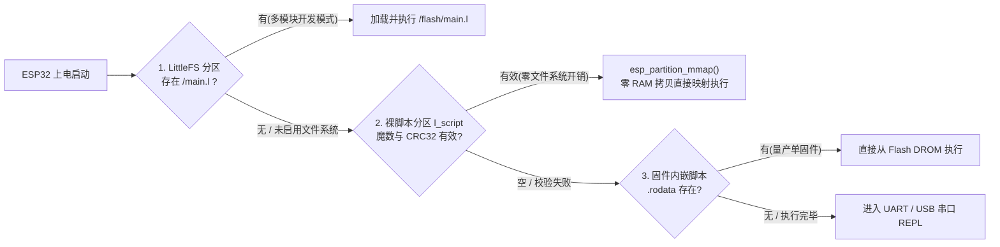

# L 语言设计梳理与 ESP32 嵌入式改进方案

> **总体定位**：L 语言专注于 **ESP32 系列（ESP32 / ESP32-S3 / ESP32-C3 / ESP32-C6，基于 ESP-IDF）**，兼具 C 语言的直观语法与 MicroPython 的交互/脚本便利，同时具备**完备的异常捕获机制（`try / catch / throw`）与精确到「文件:行:列 + 源码行指示 `^` + 调用栈回溯」的错误定位能力**。

---

## 1. 目标设备约束（ESP32 系列基线）

| 芯片型号 | 架构与主频 | 可用 SRAM | Flash 容量 | 关键硬件特性与限制 |
| :--- | :--- | :--- | :--- | :--- |
| **ESP32** | Xtensa LX6 双核 240 MHz | **~320 KB**（无 PSRAM） | 4 ~ 16 MB | 硬件仅单精度 FPU（`double` 为软浮点）；FreeRTOS 任务栈通常 4~16 KB |
| **ESP32-S3** | Xtensa LX7 双核 240 MHz | **~512 KB**（常配 2~8 MB PSRAM） | 4 ~ 16 MB | 单精度 FPU；USB Serial/JTAG 原生支持 REPL |
| **ESP32-C3** | RISC-V 单核 160 MHz | **~400 KB** | 4 MB | **无硬件 FPU**（整数运算与软浮点差距 >20 倍） |
| **ESP32-C6** | RISC-V 160 MHz | **~512 KB** | 4 ~ 8 MB | Wi-Fi 6 / BLE / Zigbee / Thread；无硬件 FPU |

---

## 2. 无文件系统 ESP32 上的脚本存储方案（推荐架构）

在 ESP32 上，不挂载 FAT/SPIFFS 文件系统也能灵活存取和运行脚本。推荐采用**「裸 Flash 分区映射 + 固件内嵌回退 + 可选 LittleFS」三级方案**：



### 2.1 方案核心：裸 Flash 脚本分区（Raw Partition + MMU 映射，强烈推荐）
- **分区定义**：在 ESP-IDF 的 `partitions.csv` 中划出 `64 KB` 自定义数据分区：
  ```csv
  # Name,    Type, SubType, Offset,  Size, Flags
  l_script,  data, 0x99,    ,        64K,
  ```
- **16 字节分区头**：
  | 偏移 | 大小 | 字段 | 说明 |
  | :--- | :--- | :--- | :--- |
  | `0x00` | 4 B | `magic` | `"LSCR"`（源码文本）或 `"LBC1"`（预编译字节码） |
  | `0x04` | 4 B | `length` | 脚本字节长度 |
  | `0x08` | 4 B | `crc32` | 内容 CRC32 校验（防止串口传输出错或断电损坏） |
  | `0x0C` | 4 B | `flags` | 预留标志位（如启动自动执行、遇错重启策略） |
- **零 SRAM 占用**：通过 `esp_partition_mmap()` 将 Flash 分区直接映射为 CPU 只读地址 `const char *src`；词法分析器、源码报错回显（`line_start`）或字节码 VM **直接在 Flash 映射区上读取，完全不占用 320 KB SRAM**。
- **串口一键更新（已落地，M6+ 加固）**：在 REPL 中收到 `\x01`（Raw Upload 指令）时擦除 `l_script` 分区并写入新脚本，收到 `\x04` 校验 CRC32 后立即热重载执行。M6+ 已加固：`__L_UPLOAD_READY__` 握手机制、LF 行尾归一化、64 字节分块传输、传输前预清除 Ctrl+C，杜绝 CRC32 校验失配。

### 2.2 量产补充：固件内嵌（`EMBED_TXTFILES`）
- 在 ESP-IDF `CMakeLists.txt` 中配置 `EMBED_TXTFILES "main.l"`，脚本自动进入 Flash `.rodata` 段（`_binary_main_l_start`），适合单一固件出厂交付。

### 2.3 多文件补充：LittleFS（按需开启）
- 当项目需要使用 `import "./sensor.l"` 多模块拆分或运行时写配置文件时，开启 `L_WITH_LITTLEFS=1`。

---

## 3. 异常与错误定位规范（已落地）

针对嵌入式设备「出错不能盲猜、故障需要自恢复」的要求，L 语言内置两层保障：

### 3.1 语法与未捕获错误：精确到文件、行、列、源码行指示 `^` 与调用栈
```text
[tests\15_method_try_pin.l:49:16] 运行时错误: 除数不能为 0
    49 |     return 100 / addr;
       |                ^
  调用栈回溯:
    at sensor_read (tests\15_method_try_pin.l:49:16)
    at app_step (tests\15_method_try_pin.l:53:23)
    at <main> (tests\15_method_try_pin.l:79:9)
```

### 3.2 结构化异常捕获：`try { ... } catch (e) { ... }` 与 `throw`
- 任何运行时错误（除零、类型错误、引脚越界、键不存在）和主动 `throw` 均可被 `try / catch` 捕获，避免设备死机。
- 捕获到的异常对象 `e`（Map）包含完整定位信息：
  | 字段 | 类型 | 说明 |
  | :--- | :--- | :--- |
  | `e.type` | `string` | `"RuntimeError"` 或 `"ThrowError"` |
  | `e.message` | `string` | 错误原因描述 |
  | `e.file` | `string` | 触发错误的文件路径（或 `"<repl>"`） |
  | `e.line` / `e.col` | `int` | 精确行号与列号 |
  | `e.fn` / `e.func` | `string` | 发生错误时的所在函数名（顶层为 `"<main>"`） |
  | `e.source` | `string` | 触发错误那一行的源码文本 |
  | `e.stack` | `array` | 调用栈回溯字符串数组 |
- 支持抛出自定义字典：`throw { code: 404, message: "I2C 传感器未响应" };`，系统会自动补全 `file / line / col / fn / source / stack` 字段。

---

## 4. 实施路线与当前进度（聚焦 ESP32 + ESP-IDF）

> **版本命名规范（方案 A - 阶段里程碑预发布后缀）**：
> 基础版本定为 `0.1.0`。各个攻坚阶段的 GitHub Release 采用 `v0.1.0-m5`、`v0.1.0-m6` 格式，既清晰对应开发进度，又避免版本号快速虚高。

| 里程碑 | 核心内容 | 状态 |
| :--- | :--- | :--- |
| **M1** | **整数 `int`(32 位) / 浮点 `float` 拆分 + 位运算**（`& \| ^ ~ << >>`、`0x`/`0b` 字面量、32 位回绕、C 语义整除） | ✅ **已完成**（`tests/14_int_float_bitops.l`） |
| **M2** | **方法调用语法 `obj.method()` + `Pin(2, "out").on()` / `pin(2).on()` + `try/catch/throw` 与精确错误定位** | ✅ **已完成**（`tests/15_method_try_pin.l`） |
| **M3** | **`ESP32` 基础功能类 + `bytes` 定长字节缓冲 + `const` 常量 + 内置外设类**（`PWM`、`ADC`、`I2C`、`SPI`、`UART`） | ✅ **已完成**（`tests/16_esp32_m3.l`） |
| **M4** | **HAL 抽象层 (`l_hal.h` / `stdlib/hal.c`) + `l_config.h` 模块裁剪 + 裸 Flash 分区 (`l_script`) 读写/CRC32/零拷贝执行** | ✅ **已完成**（`tests/17_hal_flash_m4.l`） |
| **M5** | **无线网络与 IoT 核心支持 (`WiFi` STA/SoftAP + `HTTP` 客户端 + `SNTP` 网络对时 + `ESP32.status()` 看板)** | ✅ **已完成**（`tests/18_net_wifi_http.l`） |
| **M6** | **字节码编译器 + 栈式 VM**（消除 C 递归栈占用，执行前释放 AST，单循环执行，预编译 `.lc` 二进制直接加载） | ✅ **已完成**（`tests/19_vm_bytecode.l`） |
| **M6+** | **M6 之后收尾**（ESP32 阻塞式 REPL、串口上传协议加固：`__L_UPLOAD_READY__` 握手 / LF 归一化 / 64B 分块 / CRC32 校验、`connect()` 远程代码执行 + `-e` 命令行参数、PC 端 Inno Setup 打包、自动版本号 `0.1.{patch}.{timestamp}`、官网 `site/`） | ✅ **已完成** |
| **M7** | **深度外设驱动库与外设事件中断**（GPIO 外部中断、软硬件 Timer 定时器中断、Deep Sleep 深度睡眠唤醒、Watchdog 看门狗） | ✅ **代码已完成**（PC 模拟 + ESP-IDF HAL 双向落地：`esp_timer` / `gpio_isr` / `esp_task_wdt` / `esp_deep_sleep_start`，见 `stdlib/hal.c` 与 `tests/20_m7_irq_timer.l`；**真机实测待做**） |
| **M7** | **固定静态堆分配器 + 值栈 GC 根扫描**（可配置如 64 KB 静态堆，适配 320 KB SRAM） | ✅ **已完成**（`l_heap.h/c` + `gc.c`，PC 全量回归通过；**真机实测待做**） |
| **M8** | **定时器 / GPIO 中断事件循环 (`Timer`、`pin.irq`)** | ✅ **已完成**（随 M7 落地：`delay_ms`/`ticks_ms`/`sleep` 心跳点统一派发，见第 9 节） |
| **M9** | **TCP Socket 标准库 (`Tcp` 类)** | ✅ **已完成**（`stdlib/net.c` + `tcp_win.c`/`tcp_posix.c`，`tests/21_tcp_socket.l`） |

### 4.1 当前状态与下一步（2026-11-13 核对代码后更新）

**当前阶段**：M1–M8 全部里程碑代码落地，处于「M7 真机验证 + 收尾打磨」阶段。

| 待办 | 优先级 | 说明 |
| :--- | :--- | :--- |
| M7 真机实测 | 高 | 在真实 ESP32/S3/C3 上验证 `pin.irq`、`Timer`、`watchdog`、`deepsleep`、静态堆 64KB 池与 GC 根扫描 |
| VM 后端补齐 | 高 | ✅ **已完成**：① 原生错误可被 VM `try/catch` 捕获（`run_loop` 每层压入 `VmRecover` 保护块，`raise_error` 检出可捕获的 VM 保护块后 longjmp）；② `tests/04_help.l`、`tests/07_gc.l` 的 `--vm` 段错误已修（GC 根缺失导致的 use-after-free、`help()` 访问空 `decl`）。同时补齐 VM 与 AST 的语义差距，`--vm` 与默认模式下 `tests/` 输出完全一致，明细见 4.2 |
| C6 固件纳入 CI | 中 | `esp32-firmware.yml` 矩阵目前只产 ESP32 / C3 / S3，C6 需本地编译 |
| macOS 包 CI 验证 | 中 | `release-pc.yml` 已改为 `macos-15` 上用 clang `-arch` 交叉出双架构，需打 tag 验证产物 |
| 官网本地下发 | 低 | `site/dl/` 目录已就位，等待上传安装包与固件 |

### 4.2 VM 后端补齐明细（2026-11-13 完成）

`tests/` 全量用例在 `--vm` 与默认（AST）模式下输出一致（差异仅剩平台环境相关项：路径/版本号/无网络）。

**崩溃与内存安全**

| 问题 | 原因 | 修复 |
| :--- | :--- | :--- |
| `07_gc.l` 段错误 | `OP_ADD` 先把两个操作数 `pop` 到 C 局部变量，再调 `str_new` 分配；GC 触发后把操作数当垃圾回收，`memcpy` 读到已释放内存 | 改为 `peek` 保留在值栈上，拼接完成后再调整栈顶 |
| 同类 GC 根缺失 | `OP_ARRAY`/`OP_MAP` 容器未入栈即填充、`OP_GET_PROP`/`OP_SET_PROP`/`OP_INDEX_GET`/`OP_INDEX_SET` 先弹栈后分配、`OP_CLOSURE` 捕获 upvalue 时闭包未入栈、`OP_DEF_GLOBAL` 先弹栈后扩容 | 统一改为「操作数/结果保持为 GC 根」或 `gc_push_root`/`gc_pop_roots` 临时根 |
| `04_help.l` 段错误 | `help(fn)` 无条件读 `f->decl->as.fn.params`，VM 闭包只有字节码原型、`decl` 为 NULL | 分支处理 `proto`，并把形参名在编译期拷进 `Proto.param_names` |
| `for` 循环里 `continue` 乱跳 | `continue_target` 只在本体编译完之后才赋值，`continue` 当刻读到未初始化值（并在 `01_basic.l` 引发栈溢出/段错误） | 占位 `OP_JUMP` 记入 `continue_jumps`，步进代码生成前回填 |

**语义对齐**

| 问题 | 修复 |
| :--- | :--- |
| 函数体内 `let` 被编译成全局变量（闭包共享同一份状态） | `compile_fn_body` 把子编译器作用域深度设为 1 |
| 原生错误无法被 VM `try/catch` 捕获 | `run_loop` 每层设置 `VmRecover` 恢复点；`raise_error` 检测可捕获的 VM 保护块后 longjmp 回去恢复栈/帧/`open_upvalues` 并跳到 catch 起始指令；VM 内 30 处内联 `fprintf` 错误统一改走 `rt_error`（带行列定位、可捕获） |
| `throw` 的异常对象缺少 `type/message/file/line/col/source/stack` | VM 与 AST 共用 `interp_throw_value`；行表 `LineInfo` 增加 `line_start`，错误对象补上 `source` 字段 |
| `obj.method()` 内 `self` 未定义 | `CallFrame` 增加 `has_self`/`self_val`，`vm_call_closure_self` 支持自动补 `self` 形参，`OP_GET_GLOBAL` 特判 `self` |
| 字符串不支持下标读取 | `OP_INDEX_GET` 补 `V_STR` 分支 |
| 浮点 `%` 报「需要整数」 | `OP_MOD` 补 `fmod` 分支（与 AST 一致） |
| `import` 语句在 VM 下被跳过 | 编译成对隐藏内置 `__import(路径[, 别名])` 的调用，执行顺序与 AST 一致 |
| `const` 赋值在 VM 下不报错 | 局部 const 生成 `OP_CONST_REASSIGN`，全局 const 用 `OP_DEF_GLOBAL_CONST` 标记 + `env_find_with_const` 检查 |

---

## 5. M2 已实现特性速览

1. **原生对象系统 (`V_OBJ` + `.rodata` 方法表)**：
   - 方法表 `ObjMethod[]` 与类定义 `ObjClass` 完全声明为 `const`（在 ESP32 上驻留 Flash DROM，零 RAM 开销）；
   - `NativeObj` 内联 `int32_t fields[4]`，创建 `Pin` 对象无需二次 `malloc`。
2. **`Pin` / `pin` 硬件引脚对象**（见 `stdlib/hw.c`）：
   - 构造：`Pin(2, "out")`、`Pin(2, "in_pullup")` 或简写 `pin(2).on()`；
   - 方法：`.on()` / `.high()`、`.off()` / `.low()`、`.toggle()`、`.value([v])`、`.mode([m])`、`.pin()`、`.info()`；
   - 在 ESP-IDF (`ESP_PLATFORM`) 下直接映射 `driver/gpio.h`；在 PC 下使用寄存器状态表模拟，方便离线验证。
3. **内置类型与自定义 Map 方法调用**：
   - 字符串支持 `.trim()`、`.upper()`、`.lower()`、`.split()`、`.replace()`、`.substr()`、`.find()`、`.len()`、`.ulen()` 等链式调用；
   - 数组支持 `.push()`、`.pop()`、`.sort()`、`.reverse()`、`.join()`、`.slice()`、`.map()`、`.filter()`、`.reduce()`、`.len()`；
   - 字典支持 `.has(k)`、`.remove(k)`、`.keys()`、`.len()`，以及自定义方法（同时支持隐式 `self.xxx` 和显式 `fn(self, ...)`）。

---

## 6. ESP32 基础功能类与 M3 已实现特性速览

1. **`ESP32` / `esp32` 基础功能类**（全局内置单例，也可通过 `import "esp32" as hw;` 导入）：
   - **芯片与版本识别**：
     - `ESP32.chip()` / `ESP32.model()`：返回当前芯片型号（`"ESP32"` / `"ESP32-S3"` / `"ESP32-C3"` / `"ESP32-C6"`）；
     - `ESP32.version()`：返回 ESP-IDF 版本号（实机调用 `esp_get_idf_version()`，PC 模拟返回 `"ESP-IDF v5.3-sim"`）；
     - `ESP32.info()`：返回完整硬件字典 `{chip, model, arch, cores, freq_mhz, sram_kb, flash_mb, psram_kb, max_pin, gpio_count, free_heap, idf, mac}`；
     - `ESP32.set_chip(model)`：在 PC 离线开发时切换模拟的目标芯片型号（自动切换对应的引脚表与硬件限制）。
   - **引脚能力查询与安全校验**：
     - `ESP32.pin_info(pin)`：查询指定 GPIO 的详细能力 `{pin, name, valid, usable, in, out, mode, value, input_only, flash, strapping, pwm, adc, note}`；
     - `ESP32.pins()`：返回当前芯片的可用引脚列表 `usable_pins`、仅输入引脚 `input_only_pins`、内部 Flash 占用引脚 `flash_pins`、Strapping 引脚 `strapping_pins` 以及默认 `I2C`/`SPI`/`UART` 引脚；
     - `ESP32.pinout()`：在终端打印格式化的当前芯片全引脚状态与功能速查表；
     - **硬件非法引脚拦截**：当对 Flash 占用引脚（如 ESP32 的 GPIO 6..11、ESP32-C3 的 GPIO 12..17）或仅输入引脚（ESP32 的 GPIO 34..39）执行输出/PWM/上拉配置时，自动抛出带精确行列号的运行时异常。
   - **系统工具函数**：
     - `ESP32.free_heap()`、`ESP32.freq([mhz])`、`ESP32.mac()`、`ESP32.ticks_ms()`、`ESP32.delay_ms(ms)`。
2. **`const` 常量声明**：
   - 支持 `const LED_PIN = 2;` 语法；运行期环境 `Env` 记录常量标志位，任何对 `const` 绑定的二次赋值或重定义均抛出精确位置的运行时错误。
3. **`bytes` 定长字节缓冲 (`V_BYTES`)**：
   - 构造：`bytes(长度)`、`bytes([0x48, 0x65])`、`bytes("ESP32")`；
   - 下标读写：`b[0] = 0xCA`、`let v = b[0]`（自动检查 `0..255` 范围与越界）；
   - 方法：`.len()`、`.hex([sep])`、`.to_str()`、`.to_array()`、`.fill(byte)`、`.slice(start, [end])`、`.u16_be(off)`、`.u16_le(off)`、`.set_u16_be(off, val)`、`.set_u16_le(off, val)`。
4. **内置硬件模块与外设类 (`PWM` / `ADC` / `I2C` / `SPI` / `UART`)**：
   - 支持无文件系统的内置模块导入：`import "esp32"`、`import "gpio"`、`import "hw"`、`import "machine"`；
   - `PWM(pin, [freq=1000], [duty=0])`：支持 `.freq([hz])`、`.duty([0..1023])`、`.duty_percent([0..100])`、`.stop()` / `.deinit()`；
   - `ADC(pin, [atten="11db"])`：校验引脚是否具备 ADC 通道，支持 `.read()`、`.read_mv()`、`.read_uv()`、`.atten(db)`、`.write_sim(raw)`；
   - `I2C([bus=0], [sda], [scl], [freq=400000])`：支持 `.scan()`、`.write(addr, data)`、`.read(addr, len)`、`.write_reg(addr, reg, data)`、`.read_reg(addr, reg, len)`、`.sim_device(addr, [init_bytes])`；
   - `SPI([bus=1], [sck], [mosi], [miso], [freq=1000000])`：支持 `.transfer(data)` / `.xfer(data)`、`.write(data)`、`.read(len, [fill])`；
   - `UART([port=1], [baud=115200], [tx], [rx])`：支持 `.write(data)`、`.read([len])`、`.read_str()`、`.any()`、`.sim_input(data)`。

---

## 7. M4 已实现特性速览（HAL 抽象层 + 模块裁剪 + 裸 Flash 脚本分区）

1. **全局编译与裁剪配置 (`l_config.h`)**：
   - 自动识别 `ESP_PLATFORM`（`L_PLATFORM_ESP_IDF` vs `L_PLATFORM_HOST`）；
   - 提供标准库按需裁剪开关：`L_WITH_STDLIB_STRING`、`L_WITH_STDLIB_MATH`、`L_WITH_STDLIB_TIME`、`L_WITH_STDLIB_IO`、`L_WITH_STDLIB_SYS`、`L_WITH_STDLIB_HW`；
   - 在无文件系统的 ESP32 固件上默认关闭 `io` 与 `sys` 模块；在 PC 宿主上也可通过 `-DL_WITH_STDLIB_IO=0 -DL_WITH_STDLIB_SYS=0` 编译出零警告的最小化二进制；
   - 提供平台自适应的 `L_GC_INIT_THRESHOLD`（ESP32 为 32 KB，PC 为 1 MB）与 `L_MAX_CALL_DEPTH`（ESP32 为 64，PC 为 256）。
2. **硬件抽象层 (`l_hal.h` + `stdlib/hal.c`)**：
   - 将时钟延时、堆内存查询、芯片信息、GPIO、PWM(LEDC)、ADC、I2C、SPI、UART 及裸 Flash 分区操作全部收敛到 `l_hal_*` 接口；
   - `stdlib/hw.c` 与 `stdlib/time.c` 不再包含任何 `#ifdef _WIN32` 或 `#ifdef ESP_PLATFORM` 平台头文件，彻底实现解释器逻辑与底层驱动分离。
3. **无文件系统裸 Flash 脚本分区 (`l_script`) 落地**：
   - 实现 16 字节 `LScriptHeader`（`magic="LSCR"`、`length`、`crc32`、`flags`）及无查表 IEEE 802.3 CRC32 校验算法；
   - 在 ESP-IDF 下调用 `esp_partition_find_first` + `esp_partition_mmap` 实现零 RAM 拷贝映射；在 PC 下使用 64 KB 模拟 Flash 缓冲区复现完整擦写与校验流程；
   - 在 `ESP32` 基础功能类上新增：
     - `ESP32.config()`：查询当前 HAL 平台、Flash 分区配置与启用的模块开关；
     - `ESP32.crc32(data)`：计算字符串或 `bytes` 的 CRC32 校验值（如 `"0xCBF43926"`）；
     - `ESP32.flash_write(code, [flags])`：计算 CRC32 并将脚本写入 `l_script` 裸分区；
     - `ESP32.flash_read()` / `ESP32.flash_info()` / `ESP32.flash_erase()`：读取、查询状态与擦除裸分区；
     - `ESP32.flash_exec()`：直接在映射的 Flash 地址上零拷贝解析并执行脚本，且脚本内异常可精确定位到 `[<flash:l_script>:行:列]` 与源码行。


---

## 8. M5 已实现特性速览（无线网络与 IoT 核心支持 + 系统看板）

1. **`WiFi` 无线网络连接与热点**：
   - `wifi_connect(ssid, [pwd], [timeout_ms])`：连接 2.4GHz WiFi 热点，支持 WPA/WPA2/开放网络；
   - `wifi_disconnect()`：主动断开网络连接；
   - `wifi_is_connected()`：查询是否处于连网就绪状态；
   - `wifi_ssid()`：获取当前连接的 WiFi 名称（SSID）；
   - `wifi_ip()`：获取当前局域网 IPv4 地址；
   - `wifi_mac()`：获取网卡物理 MAC 地址；
   - `wifi_scan()`：扫描周围热点列表（包含 `ssid`, `rssi`, `auth`）；
   - `wifi_ap(ssid, [pwd])`：开启 SoftAP 本地热点。
2. **`HTTP` 客户端与 `SNTP` 现实对时**：
   - `http_get(url, [timeout_ms])`：发起 HTTP/HTTPS GET 请求，支持 SSL/TLS，返回 `{status, body, ok, error}`；
   - `http_post(url, [body], [headers], [timeout_ms])`：发起 HTTP/HTTPS POST 请求；
   - `sntp_sync([server], [timeout_ms])`：通过 NTP 服务器同步现实世界时钟。
3. **`ESP32.status()` 状态看板与 `ESP32.info()` 扩展**：
   - 在终端一键打印完整的运行平台（真机 vs PC 模拟器）、硬件规格、CPU 核心/主频、SRAM/堆剩余、WiFi 名称(SSID)、连接状态、局域网 IP 与 Flash 脚本分区状态；
   - `ESP32.info()` 字典新增 `wifi_connected`、`wifi_ssid`、`ip` 及 `is_hardware` 标识。
4. **VS Code 深度集成（语言特性服务）**：
   - 媲美 PHP 的高亮与颜色分层（单双引号、类与类型青色、函数声明黄色、作用域 `::` 识别）；
   - 鼠标悬停提示（Hover）：内置硬件外设类/函数及用户自定义 `fn` / `class` 文档提示；
   - 定义跳转（Go to Definition）：<kbd>Ctrl</kbd> + 鼠标左键点击任意方法或类名直接跳转至声明源码处。

---

## 9. M7 进行中特性速览（中断 / 定时器 / 看门狗 / 深度睡眠）

1. **统一事件模型（协作式事件循环）**：
   - 真机 ISR 只做入队（FreeRTOS Queue），PC 模拟同样走环形事件队列；由 `l_hal_poll_events()` 在脚本安全上下文统一派发，杜绝在 ISR 栈上执行解释器代码；
   - `ESP32.delay_ms()` / `ESP32.ticks_ms()` / `sleep()` 改为**分片睡眠 + 分片派发**，构成 L 语言的天然事件循环心跳点；
   - 回调闭包保存在隐藏全局 Map 注册表（`__l_irq_handlers` / `__l_timer_handlers`）中，由 GC 全局环境根保护，事件等待期间不会被回收。
2. **GPIO 外部中断 `pin.irq`**：
   - `pin.irq(回调, [触发方式])`：触发方式支持 `"rise"`（上升沿）/ `"fall"`（下降沿）/ `"change"`（任意跳变），回调签名 `fn(level)`；
   - `pin.irq(nil)` 注销中断；硬件非法引脚（Flash 占用等）自动拦截；
   - `pin.write_sim(电平)`：PC 离线注入外部电平跳变并按注册模式触发中断（复刻 `ADC.write_sim` / `I2C.sim_device` 的模拟调试风格）。
3. **软件定时器 `Timer` 类**：
   - `Timer(周期毫秒, 回调, [周期模式=true])`：创建即自动启动；单次定时器传 `false`；
   - 方法：`.stop()`、`.start()`、`.running()`、`.period([毫秒])`（运行中修改会热重启）、`.count()`（触发次数）；
   - 最多 8 个并发定时器（`L_MAX_SW_TIMERS`），真机映射 `esp_timer`，PC 模拟基于单调时钟扫描。
4. **Watchdog 看门狗**：
   - `ESP32.watchdog_enable(超时毫秒)` / `.watchdog_feed()` / `.watchdog_disable()`；
   - 真机映射 `esp_task_wdt`（超时复位）；PC 模拟为**可被 `try / catch` 捕获的超时错误**，方便离线验证喂狗逻辑。
5. **Deep Sleep 深度睡眠**：
   - `ESP32.deepsleep([毫秒])`：真机调用 `esp_deep_sleep_start()`（复位重启不返回）；PC 模拟仅记录唤醒原因并立即返回；
   - `ESP32.wake_reason()`：返回 `{code, reason}`（`"power_on"` / `"timer"` / `"pin"`）。
6. **平台兼容性补充**：
   - POSIX 平台时钟改用 `CLOCK_MONOTONIC`（`clock()` 在 Linux 下是 CPU 时间，会导致模拟定时器不走针）；
   - 新增 `dirent_msvc.h`：为 MSVC 提供极简 `opendir/readdir/closedir`（基于 `_findfirst`，刻意不含 `windows.h` 以避免与 `lexer.h` 的 `TokenType` 冲突），`stdlib/io.c` 自动按编译器选择。

---

## 10. M7 已实现特性速览（固定静态堆分配器 + 值栈 GC 根扫描）

1. **固定静态堆分配器 (`l_heap.h` / `l_heap.c`)**：
   - ESP-IDF 平台：解释器全部托管内存（GC 对象及其内部缓冲、字节码 Chunk、Env 表、Proto 元数据）收敛进一块**编译期定长 64KB 静态池**（`L_STATIC_HEAP_SIZE` 可覆盖），采用「首次适配 + 空闲块地址有序合并」的紧凑分配器，8 字节对齐；
   - 彻底消除运行期 `malloc` 碎片化与分配失败的不确定性，池耗尽时由 `gc_alloc` 强制回收后重试，仍失败则报出池模式与剩余字节的明确错误；
   - PC 宿主平台：`L_STATIC_HEAP_SIZE=0`（默认），`l_heap_*` 直接透传 `malloc/realloc/free`，行为与旧版完全一致，不受池大小限制；
   - 分配同源化：所有会被 GC 释放（`free_object`）的指针（Env->names 的 `strdup`、Proto->name/source_file、upvalue 数组等）统一改为 `l_heap_alloc` 分配，杜绝跨分配器释放；
   - 短生命周期的宿主 IO 缓冲（读文件、HTTP 响应、报错文本）保持 libc 分配，同作用域配对释放，互不混用。
2. **VM 值栈 GC 根扫描 (`gc.c` + `vm.c`)**：
   - `vm_init()` 将 VM 值栈注册到解释器（`in->scan_stack` / `in->scan_stack_top`），GC 标记阶段整体扫描 `[栈基址, 当前栈顶)` 区间；
   - 字节码执行期间的**所有中间值（操作数、调用参数、局部槽位）自动成为根**，修复了 GC 在 VM 执行中触发（如字符串拼接分配）时误回收栈上临时值的隐患；
   - VM 临时根不再需要手动 `gc_push_root/gc_pop_roots` 保护；`vm_free()` 自动注销注册。
3. **ESP32 SRAM 适配**：
   - `interp_run_vm()` 中的 VM 结构体（~40KB 值栈 + 帧栈）由 C 栈局部变量改为 `static` 存储，避免压爆 FreeRTOS 默认 4~16KB 任务栈；
   - 编译期可裁剪：`-DL_STATIC_HEAP_SIZE=<字节>` 自定义池大小，PC 上设为非零值亦可启用静态池复现真机行为。
4. **实现过程中发现并修复的三个隐患**（池模式压力测试暴露，libc 模式下被 malloc 行为掩盖）：
   - **扩容失败静默 SEGV**：`l_heap_realloc` 失败返回 NULL，原先 `env_define_ex`/`array_push`/`map_set`/`chunk_write` 等处未检查直接写入。新增 `gc_realloc()`（失败触发回收重试，仍失败给出请求字节数与池剩余的致命诊断）统一接管全部内部缓冲扩容；
   - **GC 水位线失真**：`bytes_allocated` 只统计 GC 对象头，不统计内部数组扩容，且 `l_heap_free_bytes()` 原先未扣除块头部开销——小块密集时头部可占池 40%+，导致 GC 迟迟不触发直至耗尽。修复：`free_bytes()` 精确扣除全部块头部（维护块计数），GC 触发条件增加"池剩余 < 请求 + 自适应水位线（容量/16，4KB~16KB）"；
   - **切分碎屑**：切分阈值过松会产生大量 <8B 碎屑空闲块破坏合并、加剧碎片化。修复：仅当尾部剩余 ≥ 块头+32B 数据时才切分，否则整块分配。
5. **配套质量保障**：
   - `l_heap` 内置调试设施：块头部 magic 金丝雀（踩踏立即 abort）、双重释放检测、`l_heap_debug_dump()` 空闲块分布转储、`l_heap_verify()` 记账一致性校验；
   - `tests/l_heap_unit_test.c`：独立于解释器的分配器单元测试（20 万次随机分配/释放/重分配 + 数据完整性校验）；
   - `tests/fib_stress.l`：fib(20) 递归 GC 压力用例，验证静态堆反复分配/回收路径；
   - 验证结果：256KB 静态池模式全量回归 20/20 通过，默认 libc 模式 20/20 通过，堆单元测试通过。

---

## 11. TCP Socket 标准库（`Tcp` 类，已落地）

1. **API**（`stdlib/net.c`）：
   - `Tcp(host, port, [timeout_ms=5000])`：创建即连接，支持 IPv4/IPv6（`getaddrinfo` 多地址尝试）；失败抛出带明确原因的可捕获错误（DNS 解析失败 / 连接被拒绝 / 超时，各附排查建议）；
   - `.send(数据)`：字符串或 `bytes`，自动循环分包直到发完，返回自身支持链式调用；
   - `.recv([最大字节=1024], [超时=2000])` / `.recv_bytes(...)`：`select` 超时控制；**超时或对方关闭返回 `nil`**（便于脚本轮询），套接字错误抛出带 `errno` 说明的错误；
   - `.close()` / `.is_connected()` / `.info()`：对象被 GC 回收时 `destroy` 回调自动关闭套接字，杜绝句柄泄漏。
2. **跨平台架构**（规避 windows.h 与词法 `TokenType` 枚举冲突，与 HAL 分层理念一致）：
   - `l_tcp.h`：纯 C 薄接口（connect/send_all/recv/close，错误诊断写入 errbuf）；
   - `stdlib/tcp_win.c`：WinSock2 实现（独立翻译单元，不包含解释器头文件）；
   - `stdlib/tcp_posix.c`：POSIX BSD 实现（Linux/macOS 宿主 + ESP-IDF lwip 复用）；
   - `net.c` 只依赖 `l_tcp.h`，Windows 构建无需额外头文件处理。
3. **回归测试**（`tests/21_tcp_socket.l`，共 21 组）：
   - 失败诊断路径：连接被拒/超时、非法端口、空主机名、关闭后操作；
   - 环回回显全流程（`run_tests.ps1` 自动启动 PowerShell TcpListener 回显服务）：文本/链式/bytes 收发、info、close、超时返回 nil；
   - 教训修正：TCP 是字节流，两次 `send` 可能分片到达，测试用循环 `recv_until` 收满期望长度；L 语言逻辑运算符是 `and`/`or` 关键字（无 `&&`）。
