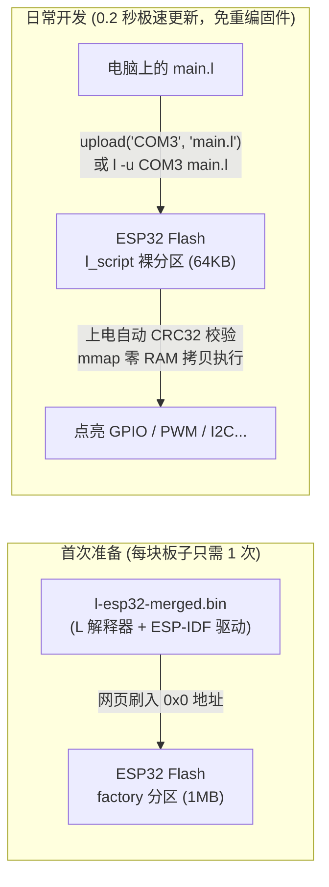

# ESP32 固件编译与刷机指南

> 本文档详细说明如何获取或编译 **L 语言 (`lang`) 的 ESP32 底包固件 (`l-esp32-merged.bin`)**、如何首次刷入开发板，以及日常如何通过串口秒级上传和调试 `.l` 脚本。

---

## 目录

1. [工作原理：为什么只需要刷一次底包固件？](#1-工作原理为什么只需要刷一次底包固件)
2. [第一步：编译或获取 ESP32 底包固件 (.bin)](#2-第一步编译或获取-esp32-底包固件-bin)
   - [方案 A（推荐 · 本机零安装）：GitHub Actions 云端自动编译](#方案-a推荐--本机零安装github-actions-云端自动编译)
   - [方案 B（本地编译）：使用 ESP-IDF 编译固件详细步骤](#方案-b本地编译使用-esp-idf-编译固件详细步骤)
3. [第二步：首次将底包固件刷入 ESP32（只需做一次）](#3-第二步首次将底包固件刷入-esp32只需做一次)
   - [方式 1（免安装软件）：使用 Chrome / Edge 浏览器网页刷机](#方式-1免安装软件使用-chrome--edge-浏览器网页刷机)
   - [方式 2：使用 esptool 命令行刷机](#方式-2使用-esptool-命令行刷机)
4. [第三步：日常编写与秒级烧录 `.l` 脚本](#4-第三步日常编写与秒级烧录-l-脚本)
   - [方式 1：在 `l.exe` 交互式界面 (REPL) 中一键操作](#方式-1在-lexe-交互式界面-repl-中一键操作)
   - [方式 2：在命令行中一键烧录与连接终端](#方式-2在命令行中一键烧录与连接终端)
   - [方式 3：使用内置网页工作台 `web_flasher.html`](#方式-3使用内置网页工作台-web_flasherhtml)
5. [分区结构与 `l_config.h` 固件裁剪说明](#5-分区结构与-l_configh-固件裁剪说明)
6. [常见问题排查 (FAQ)](#6-常见问题排查-faq)

---

## 1. 工作原理：为什么只需要刷一次底包固件？

与 MicroPython 类似，ESP32 的 CPU 本身只认识机器码。因此我们需要先给开发板刷入一个 **L 语言底包固件（`l-esp32-merged.bin`）**。



- **底包刷好后，日常写 `.l` 脚本完全不需要安装或运行 ESP-IDF，也不需要重新编译 C 代码**。
- 每次修改 `.l` 脚本后，只需通过 `upload("COM3", "main.l")` 走串口把几百字节的脚本文本写入 `l_script` 裸 Flash 分区，耗时不到 **0.2 秒**，断电不丢失，上电自动运行。

---

## 2. 第一步：编译或获取 ESP32 底包固件 (`.bin`)

我们提供 **「云端免安装自动编译」** 和 **「本地 ESP-IDF 编译」** 两种方案。如果你的电脑硬盘空间有限，强烈推荐使用 **方案 A**。

### 方案 A（推荐 · 本机零安装）：GitHub Actions 云端自动编译

项目已内置 GitHub Actions 工作流（[`.github/workflows/esp32-firmware.yml`](../.github/workflows/esp32-firmware.yml)），基于乐鑫官方 `espressif/idf:v5.3` 容器在云端自动编译并合并成单文件固件。

#### 操作步骤：
1. **推送代码到 GitHub**：
   ```powershell
   git add .
   git commit -m "build: trigger esp32 firmware build"
   git push origin main
   ```
2. **进入 GitHub Actions 页面**：
   打开你的 GitHub 仓库页面（如 `https://github.com/yongyaoli/lang`），点击顶部导航栏的 **Actions**。
   > 若希望手动触发构建，也可在左侧选择 **Build ESP32 Firmware (Cloud Zero-Install)**，点击右侧的 **Run workflow** 按钮。
3. **下载编译好的单文件固件 (`Artifacts`)**：
   等待约 2~3 分钟构建变绿后，点进该次运行记录，在页面底部的 **Artifacts** 区域下载对应芯片的固件压缩包并解压：
   | 固件包名称 | 解压后文件 | 适用开发板 / 芯片 |
   | :--- | :--- | :--- |
   | `l-firmware-esp32` | `l-esp32-merged.bin` | 经典 **ESP32**（ESP32-WROOM-32、NodeMCU-32S 等） |
   | `l-firmware-esp32c3` | `l-esp32c3-merged.bin` | **ESP32-C3**（RISC-V 单核，如合宙 ESP32-C3、SuperMini） |
   | `l-firmware-esp32s3` | `l-esp32s3-merged.bin` | **ESP32-S3**（Xtensa LX7 双核，如 ESP32-S3-DevKitC） |

> [!TIP]
> 这些 `*-merged.bin` 文件已经把 `bootloader.bin`、`partition-table.bin` 和 `l_esp32_firmware.bin` 合并在了一起，刷机时统一从偏移地址 **`0x0`** 刷入即可，不会搞错地址！

---

### 方案 B（本地编译）：使用 ESP-IDF 编译固件详细步骤

如果你本机已安装乐鑫 **ESP-IDF (v5.0 ~ v5.3)**，可以在本地直接编译 `esp32/` 目录下的固件工程：

#### 1. 打开 ESP-IDF 终端并进入固件目录
在 Windows 上打开 `ESP-IDF 5.x PowerShell`（或 Linux/macOS 下执行 `. $IDF_PATH/export.sh`），然后进入项目的 `esp32` 目录：
```powershell
cd D:\github\lang\esp32
```

#### 2. 设置目标芯片型号
根据你手头的开发板型号三选一（或设为 `esp32c6`）：
```powershell
idf.py set-target esp32      # 经典 ESP32
# 或 idf.py set-target esp32c3
# 或 idf.py set-target esp32s3
```

#### 3. 执行编译
```powershell
idf.py build
```
编译成功后，产物位于 `esp32/build/` 目录下。

#### 4. （可选）合成为单文件固件 `l-esp32-merged.bin`
为了方便分发或使用网页工具从 `0x0` 地址一次刷入，可执行以下命令将引导程序、分区表与应用固件合成为单个 `.bin`：
```powershell
cd build
esptool.py --chip esp32 merge_bin -o l-esp32-merged.bin --flash_mode dio --flash_size 4MB @flash_args
```

#### 5. 本地直接烧录并打开串口监视器
如果开发板已插在本机（假设串口为 `COM3`）：
```powershell
idf.py -p COM3 flash monitor
```

---

## 3. 第二步：首次将底包固件刷入 ESP32（只需做一次）

拿到 `l-esp32-merged.bin`（或 C3/S3 对应文件）后，用 USB 数据线将 ESP32 连接到电脑。

### 方式 1（免安装软件）：使用 Chrome / Edge 浏览器网页刷机

1. 双击打开项目中的 [`esp32/web_flasher.html`](web_flasher.html)，点击页面上的 **「打开乐鑫官方网页刷机工具 (ESP Web Flasher)」**（或直接访问 `https://espressif.github.io/esptool-js/`）。
2. 在网页中点击 **Connect**，在弹出的窗口中选择你的 ESP32 串口（如 `COM3`）。
   > 若一直连不上，请按住开发板上的 **BOOT (IO0)** 键不放，按一下 **RST (EN)** 键，再松开 BOOT 键进入下载模式。
3. 在 **Flash Address** 一栏填写 **`0x0`**，点击选择文件并选中 `l-esp32-merged.bin`。
4. 点击 **Program** 开始刷入。进度条走完后，按一下板子上的 **RST (复位)** 键即可启动 L 语言固件！

### 方式 2：使用 `esptool` 命令行刷机

如果你电脑上有 `esptool`，一行命令即可刷入：
```powershell
esptool.py --port COM3 write_flash 0x0 l-esp32-merged.bin
```

---

## 4. 第三步：日常编写与秒级烧录 `.l` 脚本

底包固件刷好后，你的 ESP32 就变成了一台可以直接运行 L 语言脚本的设备。你可以用以下任意一种方式与它交互：

### 方式 1：在 `l.exe` 交互式界面 (REPL) 中一键操作

在电脑上运行 `l.exe` 进入交互模式，输入 `help()` 或 `help("esp32")` 即可看到内置的串口函数说明：

```javascript
>>> ports()
["COM3"]

>>> // 1. 将本机写好的 main.l 通过串口烧录进 ESP32 的 l_script 裸分区并立即运行
>>> upload("COM3", "main.l")

>>> // 2. 也可以直接把一行 L 代码烧录进去
>>> upload("COM3", "pin(2).on(); print(ESP32.info());")

>>> // 3. 手头没插开发板？用 "sim" 在本机模拟 Flash 分区演练完整烧录、CRC32 校验与运行！
>>> upload("sim", "main.l")

>>> // 4. 进入 ESP32 串口远程交互终端 (在终端内敲的代码直接在芯片上运行，按 Ctrl+] 或输入 .exit 返回本机)
>>> connect("COM3")
```

### 方式 2：在命令行中一键烧录与连接终端

无需进入 REPL，直接在 PowerShell / CMD 中使用 `l.exe` 的命令行参数：

```powershell
# 1. 扫描本机可用串口
l -p

# 2. 先在电脑上离线模拟跑一遍脚本，验证语法和引脚合法性
l main.l

# 3. 一键将 main.l 烧录进 ESP32 并立即运行
l -u COM3 main.l

# 4. 打开 ESP32 串口远程交互终端
l -s COM3
```

### 方式 3：使用内置网页工作台 `web_flasher.html`

双击用 Chrome / Edge 打开 [`esp32/web_flasher.html`](web_flasher.html)：
1. 点击 **「1. 连接 ESP32 串口」**；
2. 在网页代码框中编写 `.l` 脚本；
3. 点击 **「2. 一键烧录下方 .l 脚本到 ESP32」**，下方黑色终端会实时打印 ESP32 的运行输出，也可以在底部输入框实时发送交互指令。

---

## 5. 分区结构与 `l_config.h` 固件裁剪说明

### 5.1 分区表 (`esp32/partitions.csv`)

| 分区名 | 类型 | 子类型 | 偏移地址 | 大小 | 用途说明 |
| :--- | :--- | :--- | :--- | :--- | :--- |
| `nvs` | `data` | `nvs` | `0x9000` | `24 KB` | 硬件校准与配置存储 |
| `phy_init` | `data` | `phy` | `0xF000` | `4 KB` | 射频初始化数据 |
| `factory` | `app` | `factory` | `0x10000` | `1 MB` | L 语言解释器底包固件 |
| **`l_script`** | `data` | `0x99` | 自动紧随其后 | **`64 KB`** | **无文件系统裸脚本分区（含 16B `LScriptHeader` + IEEE 802.3 CRC32）** |

### 5.2 编译期裁剪开关 (`l_config.h`)

在 [`l_config.h`](../l_config.h) 中可以通过宏开关裁剪固件体积与运行参数：

| 宏名称 | ESP32 默认值 | PC 默认值 | 说明 |
| :--- | :---: | :---: | :--- |
| `L_WITH_STDLIB_HW` | `1` | `1` | `ESP32` 基础类与 `Pin`/`PWM`/`ADC`/`I2C`/`SPI`/`UART`/`bytes` |
| `L_WITH_STDLIB_STRING` | `1` | `1` | 字符串与数组高阶函数标准库 |
| `L_WITH_STDLIB_MATH` | `1` | `1` | 数学函数库 |
| `L_WITH_STDLIB_TIME` | `1` | `1` | 时间与延时标准库 |
| `L_WITH_STDLIB_IO` | `0` | `1` | 文件系统 I/O（无文件系统裸机默认关闭） |
| `L_WITH_STDLIB_SYS` | `0` | `1` | 操作系统进程/环境变量接口（裸机默认关闭） |
| `L_GC_INIT_THRESHOLD` | `32 KB` | `1 MB` | 首次触发垃圾回收的堆内存阈值 |
| `L_MAX_CALL_DEPTH` | `64` | `256` | 最大函数调用栈深度（保护 FreeRTOS 任务栈） |

---

## 6. 常见问题排查 (FAQ)

1. **插上 ESP32 后，`l -p` 或 `ports()` 显示“未检测到可用串口”？**
   - 请确认使用的是**带数据传输功能**的 USB 线（部分充电线只有电源线）；
   - 检查 Windows 设备管理器中的「端口 (COM 和 LPT)」，若显示感叹号，请安装开发板对应的串口芯片驱动（常见为 **CH340 / CH343** 或 **CP2102**）。
2. **`upload("COM3", ...)` 提示“串口被其他程序占用”？**
   - 同一时刻只能有一个程序占用串口。如果打开了网页刷机工具、Arduino 串口监视器或其他终端窗口，请先断开或关闭它们。
3. **脚本里写了死循环 `while true { ... }`，怎么中断或更新脚本？**
   - 按一下开发板上的 **RST** 键并在刚启动时执行 `l -u COM3 new_script.l`，或在网页刷机工具中擦除/重刷即可。建议在长循环中加入 `ESP32.delay_ms(10);`。
4. **为什么执行 `Pin(6, "out")` 或 `Pin(34, "out")` 会报错？**
   - 这是 L 语言内置的 **ESP32 硬件安全护栏**：在经典 ESP32 上，GPIO 6~11 连接在芯片内部 SPI Flash 上（操作它们会导致芯片立刻崩溃），而 GPIO 34~39 是硬件仅输入引脚（无输出驱动电路）。你可以随时运行 `ESP32.pinout()` 查看整块芯片的安全可用引脚列表。
