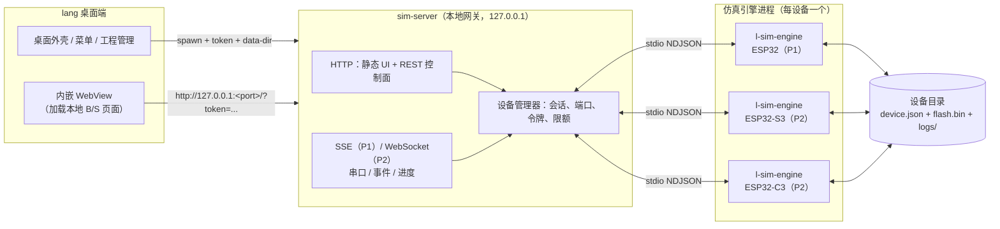
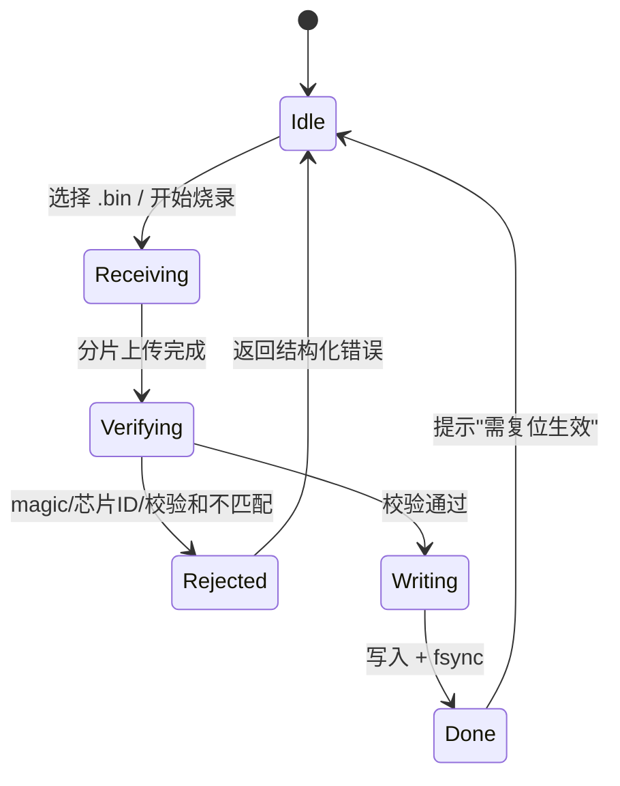
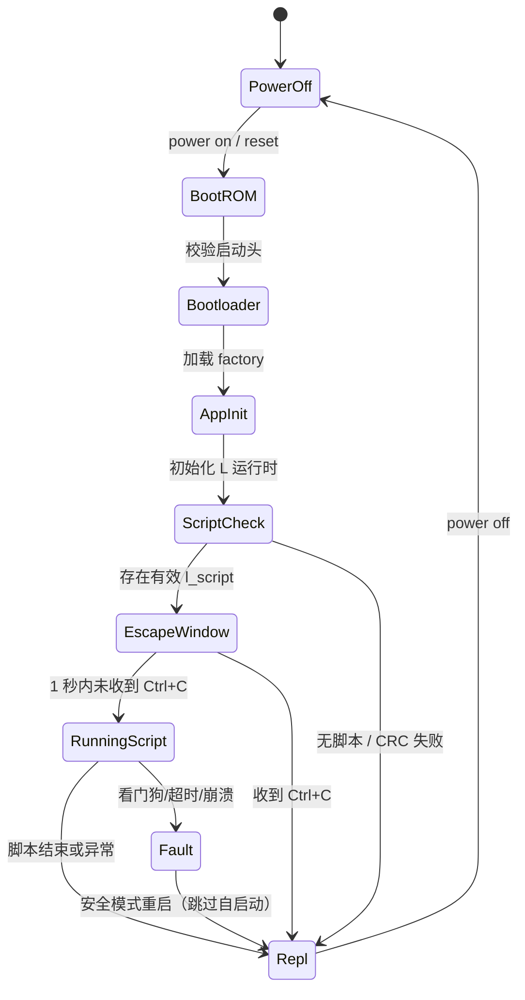

# L 语言 ESP32 仿真器方案

> 文档版本：v0.2（已确认关键决策）  
> 编写日期：2026-11-12  
> 目标读者：lang 桌面端开发者、解释器/HAL 维护者、前端开发者  
> 交付物：可打包进 lang 桌面端的 ESP32 虚拟开发板（B/S 结构 + 内嵌 WebView），支持 ESP32 / ESP32-S3 / ESP32-C3，支持模拟烧录与执行 L 脚本，并可获取结构化执行结果与板端串口输出。

---

## 0. 一页结论（TL;DR）

| 问题 | 结论 |
| :--- | :--- |
| 仿真到什么层级？ | **第一期做"功能级仿真"**：复用现有 C99 解释器 + 虚拟 HAL，不模拟 CPU 指令。 |
| 为什么不直接上 QEMU？ | 需求只要求支持 L 脚本；QEMU 包体大、外设注入难、GPL 约束、S3 支持需实测。QEMU 作为**可选二期引擎**，接口预留。 |
| 前端形态？ | **桌面端内嵌 WebView** 承载 B/S 页面，页面通过本地 HTTP/WebSocket 访问服务；WebView 只是容器，调试时仍可用浏览器打开同一地址。 |
| 网关怎么实现？ | **零依赖 C99 单文件可执行程序**，不依赖 Electron/Node/Rust；桌面外壳只需 spawn + 拼 URL，技术栈未定也可集成。 |
| 引擎放哪？ | 独立 sidecar 进程，**一台虚拟设备一个引擎进程**，规避现有 HAL 全局静态变量，同时获得崩溃隔离。 |
| "模拟烧录固件"怎么做？ | 真实校验 `.bin` 镜像头并写入虚拟 Flash 镜像，**功能级引擎不执行其指令**；UI 明确标注"仅校验/存储，不执行"。日常烧录 `.l` / `.lc` 到 `l_script` 分区并真实执行。 |
| 结果怎么拿？ | `POST /exec` 同步返回结构化 JSON（stdout / stderr / 错误行列与调用栈 / 退出原因 / 副作用快照）；长任务用 `runId` + WebSocket 流式输出。 |
| 推荐落地周期 | **P1 可运行约 8 人日（1.5～2 周）**；完整 MVP 约 **25 人日（3.5～4 周）**。 |

### 0.1 已确认决策（2026-11-12）

| 决策项 | 结论 | 对方案的影响 |
| :--- | :--- | :--- |
| 桌面端技术栈 | **尚未确定** | `sim-server` / `l-sim-engine` 均为独立 C99 可执行文件，桌面外壳可替换；集成契约固定为"spawn + token + URL"。 |
| 固件仿真层级 | **一期功能级，二期 QEMU** | 引擎接口按多实现设计；QEMU 作为可选组件按需分发，不阻塞 MVP。 |
| MVP 外设范围 | **GPIO/PWM/ADC/UART + I2C（含虚拟从机）** | SSD1306、BME280、MPU6050、24Cxx EEPROM 进 P1；SPI、WiFi/HTTP 进 P2。 |
| UI 打开方式 | **桌面端内嵌 WebView** | 页面仍为标准 B/S，WebView 只负责承载；保留浏览器直连作为调试/降级入口。 |

**MVP 范围一句话**：新建虚拟板 → 烧录底包固件（校验）→ 编辑/烧录 `.l` 到 `l_script` 分区 → 上电自启动运行 → 在 WebView 面板里看串口、点引脚、调 ADC/PWM、挂 I2C 从机、看执行结果 → 断电重启后状态仍在。

**明确不做（MVP）**：Arduino/ESP-IDF 编译、任意第三方固件指令级执行、BLE 射频、摄像头/音频、SPICE 电路求解、硬实时时序保证。

### 0.2 第一期可运行目标（P1，约 8 人日）

**结论：当前 25 人日方案是"产品 MVP"，不是"最低可运行"。** 它同时铺三颗芯片、4 类 I2C 虚拟从机、WebView 集成、多设备、快照和安装包，任何一个环节卡住都会导致"没有可运行产物"。

P1 改为**一条垂直切片**：只做 ESP32 单设备，把"启动服务 → 烧固件 → 烧脚本 → 复位 → 串口输出 → 结构化结果"整条链路跑通。其余能力在 P2/P3 增量叠加，不改协议与数据模型。

| 维度 | P1 范围 | 后移 |
| :--- | :--- | :--- |
| 芯片 | ESP32（经典款） | ESP32-S3 / ESP32-C3（P2） |
| 设备数 | 1 台（默认 DevKitC） | 多设备并发（P3） |
| 固件 | 校验官方 ESP32 `merged.bin` 并写入虚拟 Flash，不执行指令 | QEMU 真执行（P4） |
| Flash 布局 | 固定 `l_script` 偏移 `0x110000` | 解析镜像内分区表（P2） |
| 脚本 | `.l` 源码：烧录 + CRC32 + 自启动 + REPL | `.lc` 字节码（P2） |
| 串口交互 | 整行提交 + 前端本地回显 | 板端逐字符回显（P2） |
| 通信 | REST + **SSE**（服务端推送）+ POST（输入） | WebSocket（P2，可选） |
| UI | 原生 HTML/CSS/JS 单页：`textarea` + `<pre>` + 按钮 | Vue/Vite/CodeMirror/xterm（P2） |
| 外设 | GPIO 输出/输入、PWM、ADC、UART0 | I2C 虚拟从机、SPI、WiFi（P2/P3） |
| 隔离 | 进程级超时（5s 杀引擎并重启）+ 关闭 `io`/`sys` 标准库 | 指令预算、目录 jail（P2/P3） |
| 时间 | 真实时间（`delay_ms` 真等待） | 虚拟时钟 / turbo 模式（P2） |
| 集成 | 浏览器打开 + zip 分发 | WebView 内嵌、安装包、签名（P2/P3） |
| 结果 | stdout/stderr + 错误行列/调用栈 + 引脚副作用 | 快照导出、事件回放（P3） |

**P1 的简化不改变最终架构**：`sim-server` / `l-sim-engine` 进程分离、`flash.bin` 持久化、`l_script` 头格式、REST 结果模型都在 P1 固定，后续只做加法。

**P1 演示脚本（必须逐行跑通）**：

```javascript
print("chip:", ESP32.chip(), "arch:", ESP32.info().arch);

let led = pin(2).on();
let btn = pin(4, "in");
btn.irq(fn(level) { print("btn:", level); }, "rise");

let pwm = PWM(2, 5000, 512);
print("adc34:", ADC(34).read_mv(), "mV");
ESP32.delay_ms(100);
led.toggle();
print("done, heap:", ESP32.free_heap());
```

预期：串口出现 `chip: ESP32 ...`、`adc34: ... mV`、`done ...`；点 UI 的 GPIO4 按钮出现 `btn: 1`；LED 状态翻转；执行结果 JSON 的 `ok=true`，且 `sideEffects.pins` 含 GPIO2。

**P1 验收（B1～B10）**：

| 编号 | 验收动作 | 通过标准 |
| :--- | :--- | :--- |
| B1 | `sim-server --open` | 浏览器自动打开页面，显示设备"已上电" |
| B2 | 上传官方 ESP32 `merged.bin` | 校验通过并显示镜像哈希；错误芯片/损坏文件被拒绝 |
| B3 | 烧录演示脚本 | 返回 `l_script` 偏移、长度、CRC32 |
| B4 | 复位 | 1 秒内看到 Banner + 脚本输出，进入 `esp32>>>` |
| B5 | 串口输入 `ESP32.info()` | 回显正确，提示符只出现一次 |
| B6 | 制造异常（如 `1/0`） | 结果 JSON 含 `line/column/sourceLine/stack`，设备不崩 |
| B7 | 点 GPIO4 按钮 | `btn: 1` 输出，LED 状态同步到 UI |
| B8 | 断电再上电 | 自启动脚本仍执行，CRC32 一致 |
| B9 | `while true { }` | 5 秒内被终止；设备以安全模式恢复（跳过自启动），可再次烧录/运行 |
| B10 | `sim-server --headless --script tests/hello.l` | CI 下输出 JSON 结果，退出码为 0/非 0 可判定 |

**P1 必须先做的 5 个技术前置**（不能绕过，否则后期返工）：

1. **控制台 sink**：把 `printf` / `fprintf(stderr)` 收敛到可重定向的输出接口，否则拿不到结构化结果。
2. **Flash 持久化**：`flash.bin` + `l_script` 事务 + CRC32 回读，否则"断电重启"无法验收。
3. **引擎进程 + NDJSON 协议**：一行一个 JSON，先不做长度前缀与分片。
4. **最小 HTTP + SSE**：静态页、5～8 个 REST 接口、一条事件流；不实现 WebSocket。
5. **进程级看门狗**：5 秒未返回结果就杀引擎并重启，先不改进 VM 指令预算。

**P1 交付物**：`sim-server`、`l-sim-engine`、`ui/`（3 个静态文件）、`boards/esp32-devkitc-v4.json`、`tests/hello.l`、zip 包。**不含**安装程序与 WebView 壳。

---

## 1. 背景与现状

### 1.1 仓库已有能力

| 能力 | 现状 | 位置 |
| :--- | :--- | :--- |
| 解释器 / 字节码 VM | 纯 C99，零第三方依赖 | `interp.c` / `vm.c` / `compiler.c` |
| PC 端硬件仿真 | `pin` / `PWM` / `ADC` / `I2C` / `SPI` / `UART` 的宿主实现 | `stdlib/hal.c` |
| 芯片引脚约束 | ESP32 / S3 / C3 / C6 的引脚合法性、Flash 占用、仅输入、Strapping | `stdlib/hw.c` 的 `chip_specs[]` |
| 模拟烧录 | `upload("sim", "main.l")` 写入内存 Flash 并立即执行 | `stdlib/hal.c`、`stdlib/hw.c` |
| 裸 Flash 脚本分区 | 16B 头（magic/length/crc32/flags）+ 正文 + CRC32 | `l_hal.h`、`l_config.h` |
| 事件模型 | GPIO 中断、软件定时器、看门狗、深睡 | `l_hal.h` 第 14 节 |
| ESP32 固件 | 上电自检 `l_script`、1 秒 Ctrl+C 逃生、串口 REPL、串口烧录协议 | `esp32/main/app_main.c` |
| 网页刷机工作台 | 串口连接、脚本烧录、终端 | `esp32/web_flasher.html` |

### 1.2 差距

现有能力只解决"脚本能否离线跑"，还不足以称为"仿真器"：

1. **无界面**：看不到板子、引脚电平、PWM 波形、ADC 电压、I2C 帧。
2. **Flash 不持久**：`s_sim_flash` 是进程内静态数组，退出即丢失；无法模拟"断电重启后自启动"。
3. **无隔离**：HAL 全是文件级静态变量，一个进程只能有一个设备；脚本死循环会拖死宿主。
4. **无结构化结果**：`print` 直接 `printf`，错误直接写 `stderr`，桌面端无法可靠采集，也无法区分 stdout/stderr。
5. **无烧录语义**：没有 Flash 镜像、分区表、固件校验、烧录进度、擦除、回读。
6. **无多设备/快照/回放**：不能同时开 ESP32 与 C3，不能保存现场复现问题。

### 1.3 目标

- **G1**：在桌面端内嵌 WebView 中呈现一块可交互的虚拟开发板，支持三种芯片。
- **G2**：完整的"烧录 → 复位 → 启动 → 运行 → 输出"闭环，Flash 跨进程持久化。
- **G3**：脚本执行返回结构化结果，串口输出实时可见、可回放、可导出。
- **G4**：外设可注入（按键、ADC、I2C 从机、UART 输入），脚本行为与真机语义一致。
- **G5**：可被桌面端一键拉起、随桌面端退出、离线可用、安装包体积可控。
- **G6**：为未来接入 QEMU 指令级引擎预留同一套协议与 UI。

### 1.4 非目标

- 不追求周期级/寄存器级时序精确，不用于硬实时验证。
- 不模拟射频、WiFi 物理层、BLE 协议栈细节。
- 不提供 C/Arduino/MicroPython 编译能力。
- 不替代真机做功耗、EMC、USB 时序验证。

---

## 2. 参考产品与差异化

| 维度 | Velxio | Tasmota | 本方案 |
| :--- | :--- | :--- | :--- |
| 定位 | 通用电路 + 多架构仿真（QEMU/AVR/WASM） | 真实 ESP 固件（GPLv3） | L 语言专用虚拟开发板 |
| CPU 仿真 | 浏览器内 QEMU/AVR 指令级 | 真机固件 | 功能级（L 运行时 + HAL） |
| 编译 | arduino-cli / ESP-IDF | 固件预编译 | 无需编译，脚本直跑 |
| 电路 | ngspice WASM 节点分析 | 无 | 不做 SPICE，只做引脚/总线语义 |
| 外设 | 35 板、摄像头、LCD、WiFi | 丰富板型模板 | 先 GPIO/PWM/ADC/UART/I2C，再 WiFi |
| 体积/启动 | 重（WASM + 工具链） | N/A | 轻（约 5MB，启动 < 500ms） |
| 许可证风险 | AGPLv3 | GPLv3 | 自有代码；仅参考板卡数据 |

**可借鉴**：
- Velxio 的"板卡画布 + 串口监视器 + 外设滑块"交互范式。
- Tasmota 的 `templates` 板型/引脚配置思路（**只参考数据，不复制 GPL 代码**，板卡 JSON 自行整理并标注来源）。

**差异化**：L 语言自有解释器与 HAL，能在语言层精确拦截非法引脚、直接读内部状态，做到"比通用仿真器更懂 L 脚本"，且不需要工具链。

---

## 3. 总体架构

### 3.1 架构图



> **P1 只启动 E1**，且数据面用 SSE（单向推送）+ POST（输入），不实现 WebSocket；E2/E3 与 WebSocket 在 P2 增加，协议信封保持不变。

### 3.2 组件职责

| 组件 | 职责 | 不做什么 |
| :--- | :--- | :--- |
| 桌面外壳 | 启动/关闭网关、传 token、打开 UI、菜单入口、文件关联 | 不实现仿真逻辑 |
| `sim-server` | 静态资源、REST、SSE（P1）/ WS（P2）、设备生命周期、限流、鉴权、日志 | 不执行 L 脚本 |
| `l-sim-engine` | 解释器实例、虚拟时钟、HAL、Flash 镜像、外设模型、结果采集 | 不监听端口、不直接对外 |
| Web UI | P1：极简调试页；P2：板卡画布、编辑器、串口、外设面板、结果视图 | 不直接访问文件系统 |

> 桌面端技术栈尚未确定，因此**不把仿真能力绑死在外壳上**：`sim-server` 与 `l-sim-engine` 均为独立 C99 可执行文件，外壳只负责进程与 URL。即使未来选 Electron/Tauri，也建议保留该结构；WebView 只加载本地页面，不参与仿真。

### 3.3 关键取舍：为什么一台设备一个进程

- 现有 `stdlib/hal.c` 的引脚电平、Flash、I2C 从机、定时器均为文件级 `static`，单进程内多设备会互相污染。
- 进程隔离可直接解决：脚本死循环、`exit()`、`esp_deep_sleep` 模拟、崩溃恢复。
- 代价是每设备约 10～20MB 内存，桌面场景可接受。
- 后续若需 8 台以上并发，再把 HAL 重构为 `LHalContext *`，进程模型可保留为隔离层。

### 3.4 部署拓扑

| 场景 | 形态 | 说明 |
| :--- | :--- | :--- |
| 桌面端（主场景） | 桌面端 spawn `sim-server.exe`，内嵌 WebView 打开 `127.0.0.1` | 安装包自带，离线；体验统一 |
| 浏览器直连（调试/降级） | 手动启动 `sim-server.exe`，系统浏览器打开地址 | 用于开发排障与 WebView 异常时的兜底，不作为正式入口 |
| CI / 自动化 | `sim-server --headless` 或 `l-sim-engine --batch` | 输出 JSON 结果 |
| 远程（非目标） | 不提供公网监听 | 仅 loopback |

### 3.5 安全边界

- 仅绑定 `127.0.0.1`，端口 `0`（系统分配），启动后把真实端口写入握手信息。
- 启动时生成 128-bit 随机 `token`，REST 用 `Authorization: Bearer`，SSE/WS 用 `?token=`。
- 校验 `Host` 与 `Origin`，拒绝非本机来源，防 DNS rebinding。
- 静态文件路径规范化，禁止 `..` 穿越。
- 不开放 CORS；UI 与 API 同源。
- 网关退出时杀掉所有引擎；桌面端异常退出由心跳/父进程管道检测兜底。

---

## 4. 仿真引擎设计

### 4.1 引擎路线对比与决策

| 方案 | 原理 | 能执行任意 `.bin` | 体积 | 外设真实度 | 工作量 | 结论 |
| :--- | :--- | :---: | :--- | :--- | :--- | :--- |
| **A. 功能级**（推荐） | 宿主 `l` 解释器 + 虚拟 HAL + 虚拟 Flash | 否 | ~2MB | 语言/总线语义级 | 3.5～4 周 | **MVP** |
| B. 指令级 QEMU | Espressif QEMU fork，Xtensa/RISC-V | 是 | 40～80MB | 取决于 QEMU 机器与外设 | 2～3 个月 | 二期可选 |
| C. 混合 | 默认 A，按工程切换 B | 是（B） | A + 可选包 | 分层 | A + B | **目标架构** |

**决策：先 A，协议与 UI 不绑定引擎；二期用同一协议接入 B。** 理由：

1. 需求明确"支持 L 就行"，功能级已能验证脚本逻辑、引脚约束、总线交互。
2. QEMU 需要真实固件、外设设备模型、GPLv2 合规评估，且 S3/C3 的机器与外设完备度需按版本逐项实测。
3. 功能级可做到"烧录 100ms、启动 300ms、快照秒级"，体验远好于指令级。

> **重要预期管理**：功能级引擎的"烧录固件"是**校验并写入虚拟 Flash**，不是执行该 `.bin` 的机器码。UI 必须显式标注，避免用户误以为能跑 Arduino/Tasmota 固件。若必须真跑 `.bin`，直接进入二期 QEMU。

### 4.2 芯片与板卡模型

芯片参数以仓库 `stdlib/hw.c` 的 `chip_specs[]` 为唯一事实源：

| 型号 | 内核 | 核数/主频 | SRAM | Flash | GPIO 范围 | 关键约束 |
| :--- | :--- | :--- | :--- | :--- | :--- | :--- |
| ESP32 | Xtensa LX6 | 2 / 240MHz | 320KB | 4MB | 0～39 | 20/24/28～31 不存在；6～11 被 Flash 占用；34～39 仅输入 |
| ESP32-S3 | Xtensa LX7 | 2 / 240MHz | 512KB | 8MB（可选 2MB PSRAM） | 0～48 | 22～25 不存在；26～32 被 Flash/PSRAM 占用；19/20 为原生 USB |
| ESP32-C3 | RISC-V | 1 / 160MHz | 400KB | 4MB | 0～21 | 11～17 被 Flash 占用；18/19 为原生 USB |

板卡预设（`boards/*.json`，可扩展）：

| 预设 | 芯片 | 板载 LED | BOOT | 串口 | 备注 |
| :--- | :--- | :--- | :--- | :--- | :--- |
| `esp32-devkitc-v4` | ESP32 | GPIO2 | GPIO0 | UART0：GPIO1/3 | 最常见入门板 |
| `esp32-s3-devkitc-1` | ESP32-S3 | GPIO48（RGB，型号相关） | GPIO0 | UART0 + 原生 USB | PSRAM 可选 |
| `esp32-c3-devkitm-1` | ESP32-C3 | GPIO8 | GPIO9 | UART0 + 原生 USB | 兼容 SuperMini |

`board.json` 字段建议：`id`、`name`、`chip`、`flashSize`、`psram`、`ledPins`、`bootPin`、`usb`、`uartPins`、`i2cDefault`、`spiDefault`、`adcPins`、`notes`、`source`（数据来源标注）。

### 4.3 虚拟 Flash 与烧录

#### 4.3.1 Flash 镜像

- 每台设备一个 `flash.bin`（ESP32/C3 默认 4MB，S3 默认 8MB），磁盘持久化。
- 旁边一个 `device.json` 保存：芯片、板卡、固件版本与哈希、启动次数、上次启动状态、脚本元信息。
- 未写入区域为 `0xFF`（与真实 NOR Flash 擦除态一致）。
- 支持导出/导入 `.bin`，支持按区间读回（用于调试）。

参考布局（与 `esp32/partitions.csv` 对齐）：

```text
偏移        区域              大小      说明
0x000000    bootloader        ~28KB     ESP32 从 0x1000 开始；S3/C3 从 0x0
0x008000    分区表            4KB       ESP-IDF partition table
0x009000    nvs               24KB      校准/配置
0x00F000    phy_init          4KB       射频初始化
0x010000    factory app       1MB       L 解释器底包
0x110000    l_script          64KB      16B 头 + 脚本正文
0x120000    剩余               —         可扩展 OTA/用户数据
```

> 若烧录的 merged bin 自带分区表，则**以镜像内分区表为准**重新解析 `l_script` 偏移；解析失败回退到默认布局并给出警告。

#### 4.3.2 `l_script` 分区格式

与现有 `LScriptHeader` 完全一致，保证真机/仿真互通：

| 字段 | 长度 | 说明 |
| :--- | :--- | :--- |
| `magic` | 4B | `LSCR`（源码）或 `LBC1`（字节码） |
| `length` | 4B | 正文长度 |
| `crc32` | 4B | IEEE 802.3 CRC32 |
| `flags` | 4B | bit0 = 上电自启动 |
| `body` | N | UTF-8 源码或 `.lc` 字节码 |
| 结束符 | 1B | `\0` |

#### 4.3.3 烧录固件（`.bin`）



校验项（按 `esp_image_header_t` 与 `esptool` 规则）：

1. 首字节 magic = `0xE9`。
2. 镜像头 `chip_id` 与目标芯片一致（ESP32 / S3 / C3）。
3. segment 校验和；若镜像尾部带 SHA256，则一并校验。
4. 文件长度不超过 Flash 容量，写入区间不与 `l_script` 冲突（冲突则按镜像分区表重算）。

> **P1 简化**：只接受官方 ESP32 `merged.bin`，固定 `l_script` 偏移 `0x110000`，不解析镜像内分区表；S3/C3 与分区表解析在 P2。

**语义说明**：写入成功后 `device.json` 记录 `firmware.imageHash` 与 `firmware.claimedVersion`；功能级引擎启动时只显示"固件镜像已加载（功能级，不执行指令）"，实际执行内置 L 运行时。二期 QEMU 引擎则真正从 `0x0` 启动该镜像。

#### 4.3.4 烧录脚本（`.l` / `.lc`）

1. 接收源码（或文件路径），归一化换行、去除 UTF-8 BOM。
2. 计算 CRC32 与长度，校验 `length + 17 <= 64KB`。
3. 事务写入：擦除 `l_script` 区 → 写头 → 写正文 → 写 `\0` → 回读校验。
4. 可选 `autostart=true`（`flags` bit0）。
5. 返回 `{offset, length, crc32, verified:true}`；失败则整区回滚为 `0xFF`。

### 4.4 启动状态机



关键点：

- **复位语义**：`reset` 不清 Flash，但必须重建解释器实例并复位 HAL 引脚/外设状态（避免旧全局变量、回调、电平残留）；`power off/on` 等同复位 + 保留 Flash。
- **1 秒逃生窗口**：与真机固件一致，UI 提供"发送 Ctrl+C"按钮，避免死循环脚本锁死。
- **启动耗时**：功能级可配置 0～800ms 的假启动延迟（默认 200ms），让用户看到串口 Banner 逐行出现；"快速模式"可设为 0。
- **REPL**：启动完成后进入 `esp32>>>`，支持逐行执行、自动补分号、Ctrl+C 取消输入。
- **异常**：脚本未捕获异常 → 串口打印 `[文件:行:列]` + 源码行 + `^` + 调用栈，状态转为 `Repl`，设备仍可用。
- **故障恢复**：超时/崩溃后引擎以 `--skip-autostart` 重启，进入 REPL 并保留 Flash；UI 标记"上次异常"，避免坏脚本无限重启。

### 4.5 HAL 改造点

现有宿主 HAL 已覆盖大部分语义，但需要以下改造（**只列设计，不写实现**）：

| 现状 | 问题 | 改造方向 |
| :--- | :--- | :--- |
| `builtins.c` 的 `printf` | 无法采集、无法区分 stdout/stderr | 增加统一输出 sink：`l_out_write(fd, buf, len)`；默认写终端，仿真引擎路由到环形缓冲 + SSE/WS |
| `interp.c` 的 `fprintf(stderr, ...)` | 错误文本无法结构化 | 错误对象已含 `line/col/stack`；再把格式化文本写入 stderr sink |
| `l_hal_ticks_ms()` 用墙钟 | 不能快进、不可复现 | 注入虚拟时钟：`virtual` / `realtime` / `turbo` 三种模式 |
| `l_hal_delay_ms()` 真睡眠 | 慢，且阻塞 UI | 虚拟模式下推进时钟并派发到期事件；真实模式才 `sleep` |
| 引脚/Flash/I2C 全局静态 | 单进程单设备 | P1 起用"一设备一进程"；同时提供 `l_sim_reset()` 供测试 |
| Flash 静态数组 | 断电丢失 | 映射 `flash.bin`，写入后 `fsync`，启动时加载 |
| `upload("sim")` 直接执行 | 缺少烧录/复位语义 | 拆成"写 Flash 事务"与"复位启动"两步，事件化 |
| WiFi/HTTP 直连宿主 | 不可控、可能访问外网 | 默认虚拟 AP + 离线；真实网络走可选白名单代理 |
| `exit()` | 会杀掉引擎 | 引擎内捕获为"运行结束（exit code）"，由网关重启进程或保留 REPL |

建议新增（概念层）：

- `sim_console`：环形缓冲（默认 256KB），按行/按块推送到 WS，带虚拟时间戳。
- `sim_event`：统一事件总线（引脚、PWM、ADC、I2C、UART、Flash、运行状态）。
- `sim_clock`：虚拟时间 + 事件优先队列 + 预算/看门狗。
- `sim_flash`：镜像读写、分区解析、CRC、事务、快照。
- `sim_proto`：NDJSON 行编解码（内部协议）。
- `sim_json`：网关与引擎共用的轻量 JSON 解析/序列化（零第三方依赖）。

### 4.6 外设模型

| 外设 | P1 | P2/P3 | 说明 |
| :--- | :---: | :---: | :--- |
| GPIO 输出/输入/上下拉/开漏 | ✓ | | UI 点击注入电平；脚本 `write_sim` 也生效 |
| GPIO 中断（rise/fall/change） | ✓ | | 事件队列 + 时间戳；与真机 ISR 入队语义一致 |
| LEDC PWM | ✓ | | 频率/占空比 → 板载 LED 亮度 + 波形条 |
| ADC | ✓ | | 滑块/曲线注入 0～4095；按衰减换算电压 |
| UART0（控制台） | ✓ | | REPL、Banner、脚本输出、烧录协议 |
| UART1/2 | | ✓ | 回环 + 可注入 NMEA 等文本 |
| I2C 主机 | | ✓ | 扫描、读写寄存器 |
| I2C 从机 | | ✓ | 注册表 + 设备模型：SSD1306（framebuffer→UI）、BME280（温湿度/气压寄存器）、MPU6050（加速度/陀螺仪）、24Cxx EEPROM |
| SPI | | ✓ | 虚拟屏 / SD 卡扇区 |
| WiFi STA/AP | | ✓ | 模拟 AP 列表、DHCP、可选宿主 HTTP 代理（白名单） |
| SNTP | | ✓ | 虚拟时间源 |
| 定时器 / 看门狗 / 深睡 | ✓ | | 深睡模拟为"重启 + 记录唤醒原因" |
| BLE / 摄像头 / 音频 | | | 暂不做 |

外设状态通过 SSE（P1）/ WS（P2）推送（节流到 20～30Hz），UI 只做展示与注入，不承担仿真。

**P1 只做 GPIO/PWM/ADC/UART0 + 定时器/看门狗**；I2C、SPI、WiFi、UART1/2 在 P2/P3 增加。

> 引擎在 REPL 空闲、等待串口输入时必须每 ≤10ms 调用一次 `l_hal_poll_events()`，否则 UI 注入的引脚中断（B7）不会派发。真机由主循环承担这件事，仿真引擎必须显式补上。

P2 的 I2C 虚拟从机要求：

- `i2c.sim_device(addr, init)` 注册后，`scan()` 能发现；读写寄存器返回真实模型数据。
- SSD1306 按页/列写入显存，UI 以 128×64 单色画布实时渲染（支持 `0xAE/0xAF` 开关、`0xB0~0xB7` 页地址、`0x00~0x0F` 列低地址等常用命令）。
- BME280 / MPU6050 支持通过 UI 滑块改变测量值；EEPROM 掉电保持（写入 `flash.bin` 的保留区或独立 `i2c_eeprom.bin`）。
- 所有帧带虚拟时间戳，可在"总线"面板按时间顺序查看。

### 4.7 虚拟时钟与调度

| 模式 | 行为 | 用途 |
| :--- | :--- | :--- |
| `virtual`（默认） | `delay_ms(n)` 直接把虚拟时钟推进 n 毫秒，按时间顺序派发定时器/中断 | 快速跑逻辑，结果确定 |
| `realtime` | 以墙钟 1x 运行，`delay` 真等待 | 观察 LED 闪烁、串口节奏 |
| `turbo` | 不节流、不推送中间事件，仅保留最终结果 | CI 金标准测试 |

- **P1 只实现 `realtime`**：`delay_ms` 真等待，运行超时由 5 秒进程看门狗控制；`virtual` / `turbo` 在 P2 引入，用于加速与确定性回归。
- **预算**：P2 起单次运行默认 5 秒墙钟 + 1,000 万条 VM 指令（可配）；超限标记 `exitReason=timeout` 并终止。P1 只有墙钟超时。
- **看门狗**：脚本调用 `ESP32.watchdog_enable(ms)` 后，虚拟时间到期未喂狗 → 抛可捕获错误（与现有 PC 模拟一致）。
- **确定性**：随机数种子固定并记录在结果中；同一脚本 + 同一输入 + 同一模式应产生相同输出，便于回归测试。
- **事件上限**：10,000 条/次，超出丢弃并计数，防止 UI 被刷爆。

### 4.8 执行与结果模型

执行入口统一为"一次 Run"：

| 模式 | 行为 | 典型调用 |
| :--- | :--- | :--- |
| `eval` | 在当前 REPL 上下文执行一段代码 | 串口输入、桌面端"运行选中" |
| `file` | 从工程目录加载 `.l` 执行（不写 Flash） | 快速验证 |
| `flash_run` | 写 `l_script` → 复位 → 启动 → 执行 | "一键烧录并运行" |
| `boot` | 仅复位并按 Flash 内容启动 | 模拟断电重启 |

一次 Run 的结果对象（同时返回同步 JSON，并通过 SSE（P1）/ WS（P2）推送增量）：

```json
{
  "runId": "run_01J8Z3K4",
  "deviceId": "dev_esp32s3_01",
  "mode": "flash_run",
  "ok": false,
  "startedAt": "2026-11-12T10:21:33.120Z",
  "durationMs": 128,
  "virtualMs": 1200,
  "exitReason": "exception",
  "stdout": "芯片: ESP32-S3 架构: Xtensa LX7 可用内存: 512000\n",
  "stderr": "",
  "error": {
    "kind": "RuntimeError",
    "message": "除数不能为 0",
    "file": "<flash:l_script>",
    "line": 12,
    "column": 16,
    "sourceLine": "    return 100 / scale;",
    "stack": [
      "at read_sensor (sensor.l:12:16)",
      "at main_loop (sensor.l:20:14)",
      "at <main> (sensor.l:25:1)"
    ]
  },
  "sideEffects": {
    "pins": { "2": { "mode": "out", "level": 1 } },
    "pwm": { "2": { "freq": 5000, "duty": 512 } },
    "flash": { "l_script": { "length": 321, "crc32": "0x8F21AC03", "autostart": true } }
  },
  "truncated": false
}
```

规则：

- `stdout`/`stderr` 各保留最近 256KB，超出置 `truncated=true`，完整日志落盘。
- 错误必须结构化（复用解释器已有的行列与调用栈），不要只给一段文本。
- 运行结束后附"副作用快照"，方便桌面端做断言/展示。
- P1 为同步返回（执行完或超时后返回），`virtualMs` 可省略；P2 起支持异步 `runId`，结果可 `GET /runs/{id}` 或订阅 SSE/WS `run.finished`。

### 4.9 隔离、限额与安全

| 项 | 默认值 | 说明 |
| :--- | :--- | :--- |
| 单次运行墙钟 | 5s | 可配 1～60s |
| VM 指令预算 | P2 起：10,000,000 | 防无 `delay` 的死循环；P1 用进程看门狗 |
| 控制台缓冲 | 256KB | 超出滚动丢弃 |
| Flash 镜像 | 4/8MB | 按芯片 |
| 单设备内存 | 64MB | 超限杀进程并上报 |
| 文件访问 | P2 起：仅工程目录 + 设备目录 | 规范化路径，拒绝越界 |
| 网络 | 默认关闭 | P2/P3 才提供白名单代理 |
| 进程 | 一设备一进程 | 可随时强制终止 |

**P1 安全策略更简单**：编译期 `-DL_WITH_STDLIB_IO=0 -DL_WITH_STDLIB_SYS=0`，脚本不能直接读写宿主文件；`import` 由引擎内部按脚本目录只读解析。P2 再启用受限 IO 与目录 jail。`exit()` 只结束引擎进程，由网关判定为"运行结束"并可选自动重启。

---

## 5. 通信协议

### 5.1 分层

| 层 | 协议 | 用途 |
| :--- | :--- | :--- |
| 控制面 | HTTP/REST + JSON | 建/删设备、烧录、运行、复位、快照 |
| 数据面（P1） | **SSE + POST** | SSE 推送串口/引脚/运行事件；POST 发送键盘、引脚、ADC 输入 |
| 数据面（P2） | WebSocket（可选） | 低延迟双向；与 SSE 共用同一事件信封 |
| 内部 | stdio **NDJSON** | 一行一个 JSON（≤1MB）；网关 ↔ 引擎 |

> P1 网关实现建议：单线程 `select` 或"每连接一线程（上限 16）"；SSE 长连接与 POST 短连接并存；不引入第三方网络库。

所有消息共享信封：

```json
{
  "v": 1,
  "id": "evt_000042",
  "type": "serial.tx",
  "ts": 1762938000123,
  "deviceId": "dev_esp32s3_01",
  "payload": {}
}
```

### 5.2 REST 接口

| 方法 | 路径 | 说明 |
| :--- | :--- | :--- |
| GET | `/api/v1/health` | 版本、引擎能力、芯片列表 |
| GET | `/api/v1/boards` | 板卡预设 |
| POST | `/api/v1/devices` | 创建设备 `{name, chip, board, flashSize}` |
| GET | `/api/v1/devices` | 设备列表与状态 |
| GET | `/api/v1/devices/{id}` | 设备详情（芯片、Flash、固件、运行状态） |
| DELETE | `/api/v1/devices/{id}` | 删除设备（可选保留数据） |
| POST | `/api/v1/devices/{id}/power` | `{on:true/false}` |
| POST | `/api/v1/devices/{id}/reset` | `{mode:"normal"|"download"}` |
| POST | `/api/v1/devices/{id}/flash/firmware` | 分片上传 `.bin`，返回进度与校验结果 |
| POST | `/api/v1/devices/{id}/flash/script` | 写 `.l/.lc`，`{source, autostart, verify}` |
| POST | `/api/v1/devices/{id}/flash/erase` | 擦除 `l_script` 或整片 |
| GET | `/api/v1/devices/{id}/flash/download` | 导出镜像（支持 `?range=`） |
| POST | `/api/v1/devices/{id}/exec` | 执行脚本，同步返回结果或 `runId` |
| POST | `/api/v1/devices/{id}/cancel` | 取消当前运行 |
| GET | `/api/v1/runs/{runId}` | 查询结果/日志 |
| POST | `/api/v1/devices/{id}/input` | 注入串口/引脚/ADC/I2C 输入 |
| GET | `/api/v1/devices/{id}/events` | SSE 事件流（P1）；P2 可选 WebSocket |
| POST | `/api/v1/devices/{id}/snapshot` | 导出快照（zip：flash + 状态 + 日志） |
| POST | `/api/v1/devices/{id}/snapshot/restore` | 恢复快照 |
| POST | `/api/v1/shutdown` | 优雅关闭（桌面端退出时） |

状态码约定：`200` 成功、`201` 已创建、`202` 已接受（异步运行）、`400` 参数错误、`404` 不存在、`409` 设备忙、`413` 超限、`422` 校验失败、`500` 引擎错误。

**P1 只实现**：`health`、`GET /devices/{id}`、`flash/firmware`（整包上传）、`flash/script`、`exec`、`reset`、`input`、`events`（SSE）、`shutdown`。分片上传、快照、多设备、`cancel`、`runs` 查询在 P2/P3 增加。

### 5.3 事件流（P1：SSE；P2：WebSocket）

**P1 采用 SSE**：`GET /api/v1/devices/{id}/events?token=...`，`Content-Type: text/event-stream`。服务端只推送，前端按键/引脚输入走 `POST /input`。这样第一期不需要实现 WebSocket 握手、掩码与帧协议。

```text
event: state
data: {"v":1,"type":"state.changed","ts":1762938000000,"payload":{"phase":"repl"}}

event: serial
data: {"v":1,"type":"serial.tx","ts":1762938000123,"payload":{"port":0,"data":"esp32>>> "}}
```

- 断线自动重连；前端带 `Last-Event-ID`，服务端补发最近 200 条事件。
- 事件按 20～30Hz 合并推送，避免刷爆 UI。
- 输入统一为 `POST /api/v1/devices/{id}/input`：`{"kind":"serial","data":"ESP32.info()\r"}`、`{"kind":"pin","pin":4,"level":1}`、`{"kind":"adc","pin":34,"raw":2048}`。
- **P1 串口为整行提交**：前端本地回显按键，回车时一次性 POST；`Ctrl+C` 发送 `\u0003` 取消当前输入。板端逐字符回显放到 P2。
- P2 若需要更低延迟的双向交互，再增加 WebSocket；消息类型与信封不变，前端可自动选择。

消息类型（SSE 与 WS 共用）：

| 类型 | 方向 | 说明 |
| :--- | :--- | :--- |
| `hello` | S→C | 协议版本、能力、设备状态 |
| `state.changed` | S→C | 电源、启动阶段、运行状态 |
| `serial.tx` | S→C | 板端 → 前端（UART0 输出、Banner、REPL 回显） |
| `serial.rx` | C→S | 前端 → 板端（P1 走 `POST /input`；P2 可走 WS） |
| `pin.changed` | S→C | 引脚模式/电平变化 |
| `pwm.changed` | S→C | 频率/占空比 |
| `adc.changed` | S→C | 原始值/电压 |
| `i2c.frame` | S→C | 地址、读写、数据（十六进制） |
| `flash.progress` | S→C | 擦除/写入/校验进度 |
| `run.started` | S→C | `runId`、模式、开始时间 |
| `run.output` | S→C | 增量 stdout/stderr（带序号） |
| `run.finished` | S→C | 最终结果摘要 |
| `stats` | S→C | 虚拟时间、指令数、内存、事件丢弃数 |
| `fatal` | S→C | 引擎崩溃/被杀，前端提示重连 |

示例：

```json
{"v":1,"id":"evt_43","type":"serial.tx","ts":1762938000456,
 "deviceId":"dev_esp32s3_01",
 "payload":{"port":0,"encoding":"utf8","data":"[boot] 正在执行...\r\n"}}
```

```json
{"v":1,"id":"cmd_17","type":"serial.rx","ts":1762938001000,
 "deviceId":"dev_esp32s3_01","payload":{"port":0,"data":"ESP32.info()\r"}}
```

### 5.4 引擎内部协议

P1 使用 **NDJSON**：每行一个完整 JSON 对象，UTF-8，单行 ≤1MB。选择它而不是长度前缀，是为了第一期可读、可直接用 `tail` 调试、无需处理二进制帧；JSON 字符串内的换行由转义保证。

```text
{"type":"hello","payload":{"version":1}}
{"type":"run.result","payload":{"ok":true}}
```

- 引擎的 `stdout` 只写协议行；人类可读日志走 `stderr` 或 `serial` 事件，避免污染协议。
- P1 命令子集：`hello`、`init`、`firmware.apply`、`script.flash`、`script.run`、`serial.input`、`pin.input`、`adc.input`、`reset`、`shutdown`。
- P1 事件子集：`ready`、`state`、`serial`、`pin`、`pwm`、`adc`、`run.result`、`fatal`。
- 固件不做分片：服务端先把上传流写入临时文件，再发 `firmware.apply {path}`，由引擎校验并写入 `flash.bin`。
- **背压**：P1 事件队列上限 1MB，满时丢弃最旧的 `adc/pin` 合并事件；`serial` 与 `run.result` 不丢。
- **超时**：命令 10s 未响应，网关杀引擎并重启；运行超时由 5s 看门狗控制。

### 5.5 错误码

| 码 | 含义 |
| :--- | :--- |
| `E_CHIP_MISMATCH` | 固件镜像与目标芯片不符 |
| `E_IMAGE_INVALID` | 镜像头/校验和/SHA256 失败 |
| `E_FLASH_RANGE` | 写入越界或与 `l_script` 冲突 |
| `E_SCRIPT_TOO_LARGE` | 脚本超过分区容量 |
| `E_CRC_MISMATCH` | 脚本 CRC32 不符 |
| `E_BUSY` | 设备正在运行/烧录 |
| `E_TIMEOUT` | 运行超时 |
| `E_BUDGET` | 指令预算耗尽 |
| `E_KILLED` | 被用户取消或进程被杀 |
| `E_IO_JAIL` | 文件访问越界 |

---

## 6. UI 设计（B/S + WebView 容器）

### 6.1 布局

以下为 **P2 完整布局**；P1 的极简页见本节末尾。

```text
┌──────────────────────────────────────────────────────────────────────────────┐
│ L 仿真器   [ESP32 DevKitC v4 ▾]  ● 已上电   虚拟时间 00:00:12.340   [复位] │
├───────────────────────────────┬──────────────────────────────────────────────┤
│                               │  编辑器  main.l                    [烧录并运行] │
│      板卡画布（SVG）          │  ┌────────────────────────────────────────┐  │
│   ┌─────────────┐             │  │ let led = pin(2).on();                 │  │
│   │   ESP32     │  LED ●      │  │ print(ESP32.chip());                   │  │
│   │   DevKitC   │  BOOT ○     │  │ ...                                    │  │
│   └─────────────┘             │  └────────────────────────────────────────┘  │
│   引脚悬停/点击注入电平       │  结果  ✓ 完成 128ms   [JSON] [复制] [导出]    │
│                               │  ┌────────────────────────────────────────┐  │
├───────────────────────────────┤  │ stdout / 结构化错误 / 副作用快照       │  │
│ 外设面板                      │  └────────────────────────────────────────┘  │
│ [GPIO] [PWM] [ADC] [I2C]      ├──────────────────────────────────────────────┤
│ [UART] [WiFi]                 │  串口监视器  esp32>>> _           [清屏][Ctrl+C]│
└───────────────────────────────┴──────────────────────────────────────────────┘
```

**P1 先做极简页**（不引入构建链）：

- 顶部：设备状态、`复位`、`烧录固件`、`烧录并运行`。
- 左栏：GPIO2 LED、GPIO4 按钮、ADC34 滑块、PWM 占空比滑块。
- 中间：`<textarea>` 写脚本（等宽字体，不做语法高亮）。
- 下方：`<pre>` 串口输出（SSE 追加）+ `<details>` 展示结果 JSON。
- 仅 3 个静态文件：`index.html` / `app.js` / `style.css`；无 npm、无打包。

P2 再替换为下面 6.1 的完整布局与组件化实现。

### 6.2 核心交互流程

1. **新建虚拟板**：选芯片（ESP32/S3/C3）→ 选板卡预设 → 生成设备目录。
2. **烧录底包**：拖入官方 `l-esp32*-merged.bin` → 显示校验项与进度 → 提示"功能级引擎不执行其指令"。
3. **写脚本**：内置编辑器（语法高亮可复用 `editors/vscode` 的 TextMate 语法）→ Ctrl+S 保存到工程。
4. **一键烧录并运行**：写 `l_script` → 复位 → 1 秒逃生窗口 → 执行 → 串口与结果同步刷新。
5. **注入输入**：点板载按键、拖 ADC 滑块、挂 I2C 从机、发送串口命令。
6. **观察**：LED 亮度、PWM 占空比、引脚电平表、I2C 帧、执行时间线。
7. **保存/复现**：快照导出（Flash + 外设状态 + 日志），可分享给他人一键还原。

> P1 只实现 1～4 的最小版（单设备、无 I2C、无快照）；5～7 在 P2/P3 补齐。

### 6.3 组件与技术选型

| 模块 | P1 建议 | P2 升级 | 理由 |
| :--- | :--- | :--- | :--- |
| 运行容器 | 系统浏览器 | 桌面端 WebView（WebView2 / WKWebView / WebKitGTK） | P1 先证明链路，P2 再统一体验 |
| 页面实现 | 原生 HTML/CSS/JS，3 个文件 | Vue 3 + Vite（或 React + Vite） | P1 零构建、零依赖、当天可跑 |
| 状态 | 全局对象 + 轮询/SSE | Pinia / 轻量 store | P1 只有一个设备，不需要状态库 |
| 板卡画布 | 简单 HTML 引脚表 + LED/按钮 | SVG 板卡图 + 原生事件 | P1 不画板，先保证可用 |
| 编辑器 | `<textarea>` | CodeMirror 6 | P1 不做语法高亮 |
| 串口 | `<pre>` + SSE 追加 | xterm.js | P1 不需要 ANSI/回滚 |
| 图表 | 数字/滑块 | 原生 SVG 波形（自绘） | PWM/ADC 数据量小 |
| 通信 | 同源 `fetch` + `EventSource` | 增加 WebSocket（可选） | SSE 足够 P1 的单向事件流 |
| 样式 | 单文件 CSS | 设计令牌 + 官网风格 | 离线可用 |

约束：P2 构建产物 < 2MB（gzip 后），无 CDN、无外部字体、无遥测；只使用三端 WebView 均支持的标准 API，避免 Chromium 实验特性。

> **P1 不引入 Vue/Vite/CodeMirror/xterm**。先用最小页面把"烧录 → 复位 → 串口 → 结果"跑通，避免第一期被前端工程化拖住。

WebView 适配要求：

- Windows 需检测并按需引导安装 **WebView2 Runtime**（Win10/11 通常已内置）；macOS 使用 WKWebView；Linux 需系统 WebKitGTK。
- 键盘映射：焦点在终端时，`Ctrl+C` 发送 `0x03` 到串口（与复制快捷键区分）；`Ctrl+]` 退出终端；`Ctrl+S` 保存脚本。
- 文件拖放走 WebView 的受控接口，不把本地绝对路径直接暴露给页面脚本。
- WebView 仅允许导航到本机 loopback 地址，禁止外部跳转、弹窗与任意下载。
- DevTools 仅在调试构建开放；正式版通过日志与"导出诊断包"排障。
- 保留"在浏览器中打开"作为隐藏排障开关，不作为正式入口。

---

## 7. 与 lang 生态集成

### 7.1 桌面端

- 菜单：`工具 → ESP32 仿真器`；首次打开时创建默认设备。
- 启动流程：桌面端选择空闲端口 → spawn `sim-server --port 0 --token <random> --data-dir <appdata>/lang/sim` → 读取 stdout 握手 JSON `{port, token, version}` → 用**内嵌 WebView** 加载 `http://127.0.0.1:<port>/?token=...`；不调用系统默认浏览器。
- WebView 初始化：仅允许本机同源导航；关闭新窗口/下载/外部协议；调试构建才开 DevTools。
- 生命周期：桌面端退出前调用 `/api/v1/shutdown`；超时则杀进程树。
- 单实例：已有服务则复用（通过 `%APPDATA%/lang/sim/server.json` 记录端口与 token）。
- 工程联动：当前打开的 `.l` 文件路径传给 UI（`?project=...`），"运行"直接读取该文件。
- 降级：WebView 无法初始化时，提示用户检查 WebView2/WebKitGTK，并提供"浏览器打开"的排障按钮。

### 7.2 CLI 与虚拟串口

| 现有用法 | 仿真器对应 |
| :--- | :--- |
| `l main.l` | `POST /exec {mode:"file"}`（不写 Flash） |
| `upload("sim", "main.l")` | `POST /flash/script` + `reset` |
| `ESP32.flash_exec()` | `POST /exec {mode:"boot"}` |
| `connect("COM3")` | SSE `serial.tx` + POST `serial.rx` 全双工（P2 可换 WS） |
| `ports()` | 返回 `["sim0"]`（虚拟端口） |
| `l -u COM3 main.l` | 可选：`l -u sim0 main.l` 通过本地 HTTP 调用仿真器 |

**虚拟串口驱动不做默认方案**：Windows 下需签名驱动（com0com），权限与杀软风险高。P1 用 HTTP API + 内置终端；若确有"必须让现有 `l -u COMx` 零改动可用"的需求，再评估虚拟串口对。

### 7.3 文件与工程

- 设备数据目录：`%APPDATA%/lang/sim/devices/<deviceId>/`（`device.json`、`flash.bin`、`logs/`、`snapshots/`）。
- 工程可提交 `sim.json`（芯片、板卡、脚本、外设初始状态），实现"克隆即复现"。
- `.lsim` 单文件包（zip）：设备配置 + Flash 镜像 + 日志，便于发 Issue。

---

## 8. 打包与发布

### 8.1 产物

| 文件 | 说明 | 预估体积 |
| :--- | :--- | :--- |
| `sim-server` | 本地 HTTP 网关（P1：REST + SSE；P2：WebSocket） | 0.5～1MB |
| `l-sim-engine` | 解释器 + 虚拟 HAL + 设备模型 | 1.5～2.5MB |
| `ui/` | 前端静态资源（P1：3 个文件） | P1 < 100KB；P2 1～2MB |
| `boards/*.json` | 板卡预设 | < 50KB |
| `firmware/*.bin` | 可选，官方底包（按需下载） | 3×~1MB |
| WebView 运行时 | Windows 按需引导 WebView2；macOS/Linux 用系统组件 | 0（或 ~2MB bootstrapper） |
| （二期）`qemu/` | 可选引擎包 | 40～80MB |

> **P1 只交付 zip**：`sim-server` + `l-sim-engine` + `ui/` + 板卡 JSON + `tests/hello.l`，解压后 `sim-server --open` 即可运行。安装包、WebView 集成、代码签名放到 P2/P3。

### 8.2 目录

```text
simulators/
├── 模拟器.md                 # 本文档
├── engine/                   # C99 引擎源码
├── server/                   # C99 网关（零依赖，不与桌面端技术栈耦合）
├── ui/                       # P1：3 个静态文件；P2：前端工程
├── boards/                   # esp32-devkitc-v4.json 等
├── firmware/                 # 可选固件镜像（不入库大文件）
├── tests/                    # 协议、金标准、e2e
└── dist/                     # 构建产物（不入库）
```

安装包内放置于 `resources/simulators/`，版本号与 `l.exe` 同步（复用 `scripts/bump_version.ps1`）。

### 8.3 平台与安装

- Windows：随 Inno Setup 安装包分发；不注册服务、不开机自启；首次监听仅 loopback；安装时检测 WebView2 Runtime，缺失则引导安装。
- macOS：`.app/Contents/Resources/simulators/`；如需公证，子进程一并签名；使用系统 WKWebView。
- Linux：AppImage/deb 内附带；无 root 依赖；声明 WebKitGTK 依赖，缺失时给出明确提示。
- 桌面外壳：无论最终选 Electron、Tauri 还是自绘壳，均通过"spawn + token + URL"接入，不静态链接引擎。
- 端口：动态分配，避免 8080 冲突；日志写入 `%APPDATA%/lang/sim/logs/`。
- 杀软：子进程 + 本地监听可能触发误报，需代码签名并在安装说明中解释。
- **P1 不涉及安装**：只提供解压即用的 zip 与 `sim-server --open`；安装包、WebView 检测、签名在 P2/P3 执行。

---

## 9. 验收标准与测试

> **P1 的发布门槛是 0.2 节的 B1～B10**；P1 未全部通过不进入 P2。下面 A1～A18 是完整 MVP（P2/P3）的验收。

### 9.1 功能验收（P2/P3）

> A3、A5～A11 的 ESP32 部分已由 P1 的 B1～B10 覆盖；A1/A2/A4/A12 在 P2 验证，A13～A18 在 P3 验证。

| 编号 | 用例 | 通过标准 |
| :--- | :--- | :--- |
| A1 | 三种芯片各建一台设备 | 引脚范围、SRAM/Flash 信息正确 |
| A2 | ESP32 上 `Pin(6,"out")` / `Pin(34,"out")` | 报错且行列准确，不崩溃 |
| A3 | 烧录 4MB merged bin | 校验通过、进度到 100%、复位后显示镜像信息 |
| A4 | 烧录错误芯片的 bin | 返回 `E_CHIP_MISMATCH`，Flash 不被破坏 |
| A5 | 烧录脚本 → 断电 → 上电 | 自动执行，CRC32 一致 |
| A6 | 篡改 Flash 正文后启动 | 报 CRC 失败并进入 REPL，不执行 |
| A7 | 脚本打印 + 异常 | 结果 JSON 含 stdout、错误行列、源码行、调用栈 |
| A8 | 串口输入 `ESP32.info()` | 终端回显、结果正确、提示符只出现一次 |
| A9 | 死循环 `while true {}` | 5 秒内被终止，设备可复位恢复 |
| A10 | GPIO 中断 + `write_sim` | 回调触发次数与顺序正确 |
| A11 | PWM/ADC 注入 | UI 波形/电压与脚本读数一致 |
| A12 | I2C 挂 SSD1306 / BME280 / MPU6050 | `scan()` 能发现；SSD1306 显存写入后 UI 出现对应像素；传感器读数与 UI 滑块一致 |
| A13 | 两台设备并发 | 事件、串口、Flash 互不串扰 |
| A14 | 快照导出/还原 | 还原后行为与导出时一致 |
| A15 | 桌面端启动/退出 | 服务随开随关，无残留进程/端口 |
| A16 | 离线环境 | 全功能可用，无外部请求 |
| A17 | 内嵌 WebView 打开/关闭 | 首屏正常、无外部导航、关闭后服务与引擎全部退出 |
| A18 | WebView 运行时缺失 | 给出明确安装指引与"浏览器打开"降级入口 |

### 9.2 性能指标

| 指标 | 目标 |
| :--- | :--- |
| 网关启动 | < 300ms |
| P1 页面首屏 | < 300ms（本机浏览器） |
| WebView 首屏（P2） | < 800ms |
| 引擎启动 | < 200ms |
| 脚本烧录（≤64KB） | < 100ms |
| 上电到 REPL | < 500ms（快速模式 < 100ms） |
| 串口往返延迟 | < 30ms（本机） |
| 空闲 CPU | < 1% / 设备 |
| 内存 | < 30MB / 设备 |
| 连续运行 | 8 小时无泄漏、无句柄增长 |

### 9.3 自动化

- **金标准**：复用 `tests/*.l` 与 `*.out`；P1 用 realtime + 超时，P2 起在 `turbo` 模式逐字节比对 stdout。
- **协议测试**：REST/SSE/WS schema 校验、错误码、超时、背压；P1 至少覆盖 REST + SSE 断线重连。
- **e2e**：P1 用 `curl` + 一条 shell 脚本跑通 B1～B10；P2 起用 Playwright 覆盖建板 → 烧录 → 运行 → 读结果（直接对本地服务，不依赖 WebView）。
- **WebView 冒烟**：Windows WebView2、macOS WKWebView、Linux WebKitGTK 各跑一次启动/串口/关闭流程。
- **Fuzz**：镜像头、分区表、脚本长度、CRC、JSON 帧。
- **无头 CLI**：`sim-server --headless --chip ESP32 --script tests/hello.l --timeout 5 --json`，供 CI 使用。

---

## 10. 里程碑与排期（单人估算）

| 阶段 | 内容 | 工期 | 累计 | 退出标准 |
| :--- | :--- | :--- | :--- | :--- |
| P0 | 技术验证：console sink、`flash.bin`、HTTP hello、SSE 单事件 | 1d | 1d | 浏览器收到一条 SSE 事件 |
| **P1 最小可运行** | ESP32 单设备：固件校验/写入、脚本烧录/CRC、复位/REPL、结果 JSON、GPIO/PWM/ADC、极简页、zip | 8d | **9d** | **B1～B10 全通过** |
| P2 三芯片与外设 | ESP32-S3/C3、I2C 虚拟从机、WebView、Vue/CodeMirror/xterm、虚拟时钟、分区表解析 | 9d | 18d | A1～A12 通过 |
| P3 产品化 | 多设备、快照、多实例、安装包、签名、限额、8 小时稳定性 | 7d | **25d** | A13～A18、性能指标通过 |
| **MVP 合计** | | **≈ 25 人日（3.5～4 周）** | | |
| P4（可选） | QEMU 引擎 spike（ESP32 先跑通） | 5d | — | 真实 bin 能启动并输出串口 |
| P5（可选） | QEMU 三芯片 + 外设注入 + 可选包下载 | 15～20d | — | 与功能级共用协议/UI |

**第一个可运行节点在第 9 个工作日（P1 结束），不是第 25 天。** 之后 P2、P3 每期结束都是可运行、可演示、可回归的状态。

> 以上为净开发时间，不含评审、联调与缓冲；建议按 +20% 管理（P1 实际预留 10 天）。P2 的 UI 采用渐进式：先扩展极简页的 I2C 面板，再替换为 Vue/CodeMirror/xterm；WebView 只做容器，约 1 天。

建议顺序：先做 P1 的"一台 ESP32 跑通全链路"，再横向扩芯片；不要一开始铺三块板 + 全部外设。

---

## 11. 风险与对策

| 风险 | 影响 | 对策 |
| :--- | :--- | :--- |
| 用户以为能跑任意 ESP32 固件 | 期望落差、口碑 | UI 明确"功能级"；文档写清；二期 QEMU 明码标注 |
| QEMU GPLv2 合规 | 分发/闭源风险 | 独立进程、可选下载、提供源码获取方式；上线前法务评估 |
| QEMU 对 S3/C3 外设覆盖不足 | 二期功能不齐 | 先做 ESP32 spike，按实测能力分级标注 |
| HAL 全局静态状态 | 多设备串扰 | 一设备一进程；后续 context 化 |
| 时序不精确 | 用户拿仿真器调硬实时 | 文档声明；提供 `realtime` 模式与波形，但不承诺周期精度 |
| WiFi/HTTP 访问宿主网络 | 安全与不可复现 | 默认关闭；P2 白名单代理；记录所有请求 |
| 脚本死循环/内存爆炸 | 卡死 UI | P1 时间看门狗 + 进程 kill；P2 增加 VM 指令预算 |
| 跨平台 WebView 差异 | 部分功能在某一端异常 | 只用标准 API；三端冒烟；异常时降级到浏览器；必要时二期内置固定内核 |
| 桌面端技术栈未定 | 集成方式反复 | 网关/引擎以独立进程 + HTTP/WS 契约交付，外壳只做 spawn 与 URL |
| 端口占用/防火墙弹窗 | 安装体验差 | 动态端口 + 仅 loopback；安装说明 |
| 杀软误报 | 无法安装 | 代码签名、无自启、无服务注册 |
| Tasmota 等 GPL 数据 | 许可证污染 | 仅参考数据、独立整理 JSON、注明来源，不复制代码 |
| 包体膨胀 | 更新困难 | UI 构建限额；QEMU 做可选组件按需下载 |

---

## 12. 决策状态与剩余问题

### 12.1 已确认（不再阻塞设计）

| 决策项 | 结论 |
| :--- | :--- |
| 桌面端技术栈 | 尚未确定；按零依赖 C 网关设计，外壳可替换 |
| 固件仿真 | 一期功能级；二期 QEMU 作为可选组件 |
| MVP 外设 | GPIO / PWM / ADC / UART + I2C（含 SSD1306、BME280、MPU6050、EEPROM） |
| UI 形态 | 桌面端内嵌 WebView，加载本地 B/S 页面 |
| 第一期范围 | ESP32 单设备 + REST/SSE + 原生极简页面（P1，约 8 人日，第 9 天可运行） |

### 12.2 仍需确认（不阻塞开工，但影响 P2/P3 细节）

1. **虚拟串口兼容**：是否必须让现有 `l -u COM3 main.l` 零改动指向仿真器？这需要虚拟串口驱动（com0com 等签名驱动），风险与成本较高；若不必须，P1 只提供 HTTP API + 内置终端。
2. **多设备并发**：是否需要同时运行多块板（如 ESP32 + C3 联调）？若需要，是否接受"每设备一进程"的内存开销（约 10～20MB/设备）？
3. **快照/分享**：是否需要把设备现场导出给他人复现（`.lsim` 包）？若需要，P3 增加 1～2 天。
4. **许可证**：桌面端是否闭源分发？这直接影响 QEMU 二期的集成方式（GPLv2 义务）。
5. **WebView 内核策略**：P2 用系统 WebView（体积小、依赖系统）；是否要求三端渲染完全一致？若要求，需内置固定内核（+30～80MB），排期与包体都会增加。
6. **固件镜像分发**：安装包内置三份官方 `merged.bin`（约 3MB），还是首次使用时从官网/GitHub 下载？前者离线友好，后者包体更小。

> 第 2、3 项若不做，P3 可缩短 2～3 天；第 1、4、5、6 项只影响实现细节与分发策略，不阻塞开工。

---

## 附录 A：与真机固件的行为对齐清单

| 行为 | 真机 | 仿真器（P1） | 备注 |
| :--- | :--- | :--- | :--- |
| 上电执行 `l_script` | 1 秒 Ctrl+C 逃生 | 一致 | 可配置窗口 |
| CRC32 失败 | 跳过并告警 | 一致 | 进入 REPL |
| `upload` 协议 | `__L_UPLOAD_BEGIN__` / `READY` / `OK` | 内部改为 REST，但保留协议解析用于兼容 | 可选透传 |
| 串口 REPL 提示符 | `esp32>>> ` | 一致 | 只在执行完打印一次 |
| 引脚非法 | 运行时错误 | 一致 | 复用 `check_pin_usable` |
| 深度睡眠 | 复位重启 | 模拟复位 + `wake_reason` | |
| 看门狗 | 系统复位 | 可捕获错误（PC 现有语义） | 文档说明差异 |
| Flash 掉电保持 | 是 | 是（`flash.bin`） | |
| 固件指令执行 | 是 | 否 | 功能级边界，UI 标注 |

## 附录 B：最小可用 API 示例（调用方视角）

```text
1) POST /api/v1/devices
   {"name":"我的 ESP32-S3","chip":"ESP32-S3","board":"esp32-s3-devkitc-1"}
   → {"id":"dev_01","state":"off"}

2) POST /api/v1/devices/dev_01/flash/firmware   （multipart，带 offset=0）
   → {"ok":true,"verified":true,"chipId":"ESP32-S3","sha256":"..."}

3) POST /api/v1/devices/dev_01/flash/script
   {"source":"print(ESP32.chip()); pin(2).on();","autostart":true}
   → {"ok":true,"offset":1114112,"length":42,"crc32":"0x1A2B3C4D"}

4) POST /api/v1/devices/dev_01/reset  {"mode":"normal"}
   → 202 {"runId":"run_01"}

5) WS 订阅：serial.tx / pin.changed / run.finished
   或 GET /api/v1/runs/run_01 获取最终 JSON
```

## 附录 C：参考资料

- Velxio 官网与仿真器列表：<https://velxio.dev/zh-cn>、<https://velxio.dev/zh-cn/simulators>（QEMU/WASM、SPICE、板卡交互参考）
- Tasmota：<https://github.com/arendst/Tasmota>（板型/模板数据参考，GPLv3，不复制代码）
- 仓库内：`esp32/ESP32_GUIDE.md`、`esp32/main/app_main.c`、`stdlib/hal.c`、`stdlib/hw.c`、`l_hal.h`、`l_config.h`
- Espressif QEMU fork：<https://github.com/espressif/qemu>（GPLv2，二期评估；目标机器与外设覆盖需按版本实测）
