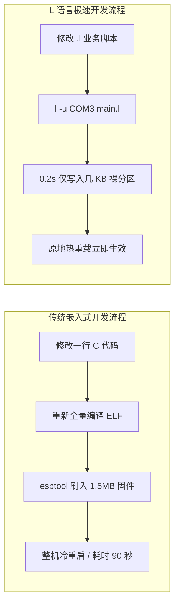

# 裸 Flash 分区与极速串口烧录原理

L 语言彻底颠覆了传统单片机每次修改代码必须全量编译固件（耗时 1~2 分钟）的笨重模式，自研了**“免文件系统裸 Flash 存储 + 串口 0.2 秒极速写入”**的技术方案。

---

## 1. 传统烧录模式 vs L 语言裸分区烧录



---

## 2. 独创 `l_script` 裸分区架构

在 ESP32 的 Flash 分区表（[`partitions.csv`](file:///d:/github/langgit/esp32/partitions.csv)）中，我们专门划出了一块独立的裸存储区：
```csv
# Name,      Type, SubType, Offset,   Size,     Flags
nvs,         data, nvs,     0x9000,   0x6000,
phy_init,    data, phy,     0xf000,   0x1000,
factory,     app,  factory, 0x10000,  0x200000,
l_script,    data, 0x99,    0x210000, 0x20000,
```

### 裸分区数据帧协议（16 字节头部）：
```text
Offset  0           4           8          12          16
+-------+-----------+-----------+----------+-----------+--------------------+
| Magic | ScriptLen |  CRC-32   |  Flags   | Reserved  | 脚本源码明文字符串... |
| 'LSCR'| (4 Bytes) | (4 Bytes) |(4 Bytes) | (4 Bytes) | (utf-8 plaintext)  |
+-------+-----------+-----------+----------+-----------+--------------------+
```

### 极致性能优势：
1. **无需挂载 FATFS / LittleFS**：没有文件系统格式化和损坏变砖的风险；
2. **`esp_partition_mmap` 零 RAM 拷贝**：ESP32 的 MMU 内存管理单元直接把 Flash 映射到 CPU 虚拟地址空间，执行大脚本时**消耗 0 字节片上宝贵的 SRAM**！
3. **IEEE 802.3 硬件 CRC32 强校验**：写入前在内存校验，只有 100% 正确才提交写入，断电不丢失，坏包自动丢弃。

---

## 3. 串口极速烧录协议 (`l -u <port> <file>`)

当您在终端输入 `l -u COM3 main.l` 时，电脑与 ESP32 之间发生如下毫秒级握手：

1. **PC 发起握手帧**：`__L_UPLOAD_BEGIN__ <长度> <CRC32> <标志>\n`
2. **ESP32 确认就绪**：回显 `__L_UPLOAD_READY__\r\n`
3. **PC 极速推流**：以 64 字节块分批注入串口，传输完毕；
4. **板端校验并固化**：计算 CRC32，一致后毫秒级写入 `l_script` 分区；
5. **板端热重载**：无需整机硬重启，解释器在内存中原地热执行新代码！
