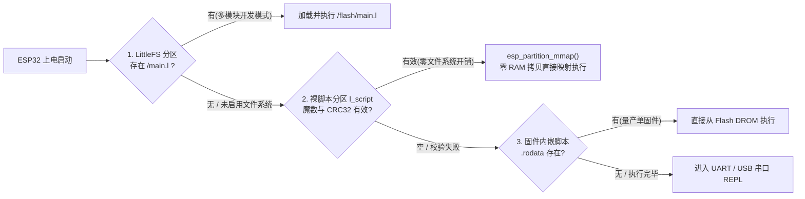

# L 语言设计梳理与 ESP32 嵌入式改进方案

> **总体定位**：L 语言专注于 **ESP32 系列（ESP32 / ESP32-S3 / ESP32-C3 / ESP32-C6，基于 ESP-IDF）**，兼具 C 语言的直观语法与 MicroPython 的交互/脚本便利，同时具备**完备的异常捕获机制（`try / catch / throw`）与精确到「文件:行:列 + 源码行指示 `^` + 调用栈回溯」的错误定位能力**。

---

## 1. 目标设备约束（ESP32 系列基线）

| 芯片型号 | 架构与主频 | 可用 SRAM | Flash 容量 | 关键硬件特性与限制 |
| :--- | :--- | :--- | :--- | :--- |
| **ESP32** | Xtensa LX6 双核 240 MHz | **~320 KB**（无 PSRAM） | 4 ~ 16 MB | 硬件仅单精度 FPU（`double` 为软浮点）；FreeRTOS 任务栈通常 4~16 KB |
| **ESP32-S3** | Xtensa LX7 双核 240 MHz | **~512 KB**（常配 2~8 MB PSRAM） | 4 ~ 16 MB | 单精度 FPU；USB Serial/JTAG 原生支持 REPL |
| **ESP32-C3** | RISC-V 单核 160 MHz | **~400 KB** | 4 MB | **无硬件 FPU**（整数运算与软浮点差距 >20 倍） |
| **ESP32-C6** | RISC-V 160 MHz | **~512 KB** | 4 ~ 8 MB | Wi-Fi 6 / BLE / Zigbee / Thread；无硬件 FPU |

---

## 2. 无文件系统 ESP32 上的脚本存储方案（推荐架构）

在 ESP32 上，不挂载 FAT/SPIFFS 文件系统也能灵活存取和运行脚本。推荐采用**「裸 Flash 分区映射 + 固件内嵌回退 + 可选 LittleFS」三级方案**：



### 2.1 方案核心：裸 Flash 脚本分区（Raw Partition + MMU 映射，强烈推荐）
- **分区定义**：在 ESP-IDF 的 `partitions.csv` 中划出 `64 KB` 自定义数据分区：
  ```csv
  # Name,    Type, SubType, Offset,  Size, Flags
  l_script,  data, 0x99,    ,        64K,
  ```
- **16 字节分区头**：
  | 偏移 | 大小 | 字段 | 说明 |
  | :--- | :--- | :--- | :--- |
  | `0x00` | 4 B | `magic` | `"LSCR"`（源码文本）或 `"LBC1"`（预编译字节码） |
  | `0x04` | 4 B | `length` | 脚本字节长度 |
  | `0x08` | 4 B | `crc32` | 内容 CRC32 校验（防止串口传输出错或断电损坏） |
  | `0x0C` | 4 B | `flags` | 预留标志位（如启动自动执行、遇错重启策略） |
- **零 SRAM 占用**：通过 `esp_partition_mmap()` 将 Flash 分区直接映射为 CPU 只读地址 `const char *src`；词法分析器、源码报错回显（`line_start`）或字节码 VM **直接在 Flash 映射区上读取，完全不占用 320 KB SRAM**。
- **串口一键更新**：在 REPL 中收到 `\x01`（Raw Upload 指令）时擦除 `l_script` 分区并写入新脚本，收到 `\x04` 校验 CRC32 后立即热重载执行，无需重编固件、无需文件系统。

### 2.2 量产补充：固件内嵌（`EMBED_TXTFILES`）
- 在 ESP-IDF `CMakeLists.txt` 中配置 `EMBED_TXTFILES "main.l"`，脚本自动进入 Flash `.rodata` 段（`_binary_main_l_start`），适合单一固件出厂交付。

### 2.3 多文件补充：LittleFS（按需开启）
- 当项目需要使用 `import "./sensor.l"` 多模块拆分或运行时写配置文件时，开启 `L_WITH_LITTLEFS=1`。

---

## 3. 异常与错误定位规范（已落地）

针对嵌入式设备「出错不能盲猜、故障需要自恢复」的要求，L 语言内置两层保障：

### 3.1 语法与未捕获错误：精确到文件、行、列、源码行指示 `^` 与调用栈
```text
[tests\15_method_try_pin.l:49:16] 运行时错误: 除数不能为 0
    49 |     return 100 / addr;
       |                ^
  调用栈回溯:
    at sensor_read (tests\15_method_try_pin.l:49:16)
    at app_step (tests\15_method_try_pin.l:53:23)
    at <main> (tests\15_method_try_pin.l:79:9)
```

### 3.2 结构化异常捕获：`try { ... } catch (e) { ... }` 与 `throw`
- 任何运行时错误（除零、类型错误、引脚越界、键不存在）和主动 `throw` 均可被 `try / catch` 捕获，避免设备死机。
- 捕获到的异常对象 `e`（Map）包含完整定位信息：
  | 字段 | 类型 | 说明 |
  | :--- | :--- | :--- |
  | `e.type` | `string` | `"RuntimeError"` 或 `"ThrowError"` |
  | `e.message` | `string` | 错误原因描述 |
  | `e.file` | `string` | 触发错误的文件路径（或 `"<repl>"`） |
  | `e.line` / `e.col` | `int` | 精确行号与列号 |
  | `e.fn` / `e.func` | `string` | 发生错误时的所在函数名（顶层为 `"<main>"`） |
  | `e.source` | `string` | 触发错误那一行的源码文本 |
  | `e.stack` | `array` | 调用栈回溯字符串数组 |
- 支持抛出自定义字典：`throw { code: 404, message: "I2C 传感器未响应" };`，系统会自动补全 `file / line / col / fn / source / stack` 字段。

---

## 4. 实施路线与当前进度（聚焦 ESP32 + ESP-IDF）

> **版本命名规范（方案 A - 阶段里程碑预发布后缀）**：
> 基础版本定为 `0.1.0`。各个攻坚阶段的 GitHub Release 采用 `v0.1.0-m5`、`v0.1.0-m6` 格式，既清晰对应开发进度，又避免版本号快速虚高。

| 里程碑 | 核心内容 | 状态 |
| :--- | :--- | :--- |
| **M1** | **整数 `int`(32 位) / 浮点 `float` 拆分 + 位运算**（`& \| ^ ~ << >>`、`0x`/`0b` 字面量、32 位回绕、C 语义整除） | ✅ **已完成**（`tests/14_int_float_bitops.l`） |
| **M2** | **方法调用语法 `obj.method()` + `Pin(2, "out").on()` / `pin(2).on()` + `try/catch/throw` 与精确错误定位** | ✅ **已完成**（`tests/15_method_try_pin.l`） |
| **M3** | **`ESP32` 基础功能类 + `bytes` 定长字节缓冲 + `const` 常量 + 内置外设类**（`PWM`、`ADC`、`I2C`、`SPI`、`UART`） | ✅ **已完成**（`tests/16_esp32_m3.l`） |
| **M4** | **HAL 抽象层 (`l_hal.h` / `stdlib/hal.c`) + `l_config.h` 模块裁剪 + 裸 Flash 分区 (`l_script`) 读写/CRC32/零拷贝执行** | ✅ **已完成**（`tests/17_hal_flash_m4.l`） |
| **M5** | **无线网络与 IoT 核心支持 (`WiFi` STA/SoftAP + `HTTP` 客户端 + `SNTP` 网络对时 + `ESP32.status()` 看板)** | ✅ **已完成**（`tests/18_net_wifi_http.l`） |
| **M6** | **字节码编译器 + 栈式 VM**（消除 C 递归栈占用，编译后释放 AST，单指令循环执行，预编译 `.lc`） | ⏳ **下一步待办** |
| **M7** | **固定静态堆分配器 + 值栈 GC 根扫描**（可配置如 64 KB 静态堆，适配 320 KB SRAM） | 待办 |
| **M8** | **定时器 / GPIO 中断事件循环 (`Timer`、`pin.irq`)** | 待办 |

---

## 5. M2 已实现特性速览

1. **原生对象系统 (`V_OBJ` + `.rodata` 方法表)**：
   - 方法表 `ObjMethod[]` 与类定义 `ObjClass` 完全声明为 `const`（在 ESP32 上驻留 Flash DROM，零 RAM 开销）；
   - `NativeObj` 内联 `int32_t fields[4]`，创建 `Pin` 对象无需二次 `malloc`。
2. **`Pin` / `pin` 硬件引脚对象**（见 `stdlib/hw.c`）：
   - 构造：`Pin(2, "out")`、`Pin(2, "in_pullup")` 或简写 `pin(2).on()`；
   - 方法：`.on()` / `.high()`、`.off()` / `.low()`、`.toggle()`、`.value([v])`、`.mode([m])`、`.pin()`、`.info()`；
   - 在 ESP-IDF (`ESP_PLATFORM`) 下直接映射 `driver/gpio.h`；在 PC 下使用寄存器状态表模拟，方便离线验证。
3. **内置类型与自定义 Map 方法调用**：
   - 字符串支持 `.trim()`、`.upper()`、`.lower()`、`.split()`、`.replace()`、`.substr()`、`.find()`、`.len()`、`.ulen()` 等链式调用；
   - 数组支持 `.push()`、`.pop()`、`.sort()`、`.reverse()`、`.join()`、`.slice()`、`.map()`、`.filter()`、`.reduce()`、`.len()`；
   - 字典支持 `.has(k)`、`.remove(k)`、`.keys()`、`.len()`，以及自定义方法（同时支持隐式 `self.xxx` 和显式 `fn(self, ...)`）。

---

## 6. ESP32 基础功能类与 M3 已实现特性速览

1. **`ESP32` / `esp32` 基础功能类**（全局内置单例，也可通过 `import "esp32" as hw;` 导入）：
   - **芯片与版本识别**：
     - `ESP32.chip()` / `ESP32.model()`：返回当前芯片型号（`"ESP32"` / `"ESP32-S3"` / `"ESP32-C3"` / `"ESP32-C6"`）；
     - `ESP32.version()`：返回 ESP-IDF 版本号（实机调用 `esp_get_idf_version()`，PC 模拟返回 `"ESP-IDF v5.3-sim"`）；
     - `ESP32.info()`：返回完整硬件字典 `{chip, model, arch, cores, freq_mhz, sram_kb, flash_mb, psram_kb, max_pin, gpio_count, free_heap, idf, mac}`；
     - `ESP32.set_chip(model)`：在 PC 离线开发时切换模拟的目标芯片型号（自动切换对应的引脚表与硬件限制）。
   - **引脚能力查询与安全校验**：
     - `ESP32.pin_info(pin)`：查询指定 GPIO 的详细能力 `{pin, name, valid, usable, in, out, mode, value, input_only, flash, strapping, pwm, adc, note}`；
     - `ESP32.pins()`：返回当前芯片的可用引脚列表 `usable_pins`、仅输入引脚 `input_only_pins`、内部 Flash 占用引脚 `flash_pins`、Strapping 引脚 `strapping_pins` 以及默认 `I2C`/`SPI`/`UART` 引脚；
     - `ESP32.pinout()`：在终端打印格式化的当前芯片全引脚状态与功能速查表；
     - **硬件非法引脚拦截**：当对 Flash 占用引脚（如 ESP32 的 GPIO 6..11、ESP32-C3 的 GPIO 12..17）或仅输入引脚（ESP32 的 GPIO 34..39）执行输出/PWM/上拉配置时，自动抛出带精确行列号的运行时异常。
   - **系统工具函数**：
     - `ESP32.free_heap()`、`ESP32.freq([mhz])`、`ESP32.mac()`、`ESP32.ticks_ms()`、`ESP32.delay_ms(ms)`。
2. **`const` 常量声明**：
   - 支持 `const LED_PIN = 2;` 语法；运行期环境 `Env` 记录常量标志位，任何对 `const` 绑定的二次赋值或重定义均抛出精确位置的运行时错误。
3. **`bytes` 定长字节缓冲 (`V_BYTES`)**：
   - 构造：`bytes(长度)`、`bytes([0x48, 0x65])`、`bytes("ESP32")`；
   - 下标读写：`b[0] = 0xCA`、`let v = b[0]`（自动检查 `0..255` 范围与越界）；
   - 方法：`.len()`、`.hex([sep])`、`.to_str()`、`.to_array()`、`.fill(byte)`、`.slice(start, [end])`、`.u16_be(off)`、`.u16_le(off)`、`.set_u16_be(off, val)`、`.set_u16_le(off, val)`。
4. **内置硬件模块与外设类 (`PWM` / `ADC` / `I2C` / `SPI` / `UART`)**：
   - 支持无文件系统的内置模块导入：`import "esp32"`、`import "gpio"`、`import "hw"`、`import "machine"`；
   - `PWM(pin, [freq=1000], [duty=0])`：支持 `.freq([hz])`、`.duty([0..1023])`、`.duty_percent([0..100])`、`.stop()` / `.deinit()`；
   - `ADC(pin, [atten="11db"])`：校验引脚是否具备 ADC 通道，支持 `.read()`、`.read_mv()`、`.read_uv()`、`.atten(db)`、`.write_sim(raw)`；
   - `I2C([bus=0], [sda], [scl], [freq=400000])`：支持 `.scan()`、`.write(addr, data)`、`.read(addr, len)`、`.write_reg(addr, reg, data)`、`.read_reg(addr, reg, len)`、`.sim_device(addr, [init_bytes])`；
   - `SPI([bus=1], [sck], [mosi], [miso], [freq=1000000])`：支持 `.transfer(data)` / `.xfer(data)`、`.write(data)`、`.read(len, [fill])`；
   - `UART([port=1], [baud=115200], [tx], [rx])`：支持 `.write(data)`、`.read([len])`、`.read_str()`、`.any()`、`.sim_input(data)`。

---

## 7. M4 已实现特性速览（HAL 抽象层 + 模块裁剪 + 裸 Flash 脚本分区）

1. **全局编译与裁剪配置 (`l_config.h`)**：
   - 自动识别 `ESP_PLATFORM`（`L_PLATFORM_ESP_IDF` vs `L_PLATFORM_HOST`）；
   - 提供标准库按需裁剪开关：`L_WITH_STDLIB_STRING`、`L_WITH_STDLIB_MATH`、`L_WITH_STDLIB_TIME`、`L_WITH_STDLIB_IO`、`L_WITH_STDLIB_SYS`、`L_WITH_STDLIB_HW`；
   - 在无文件系统的 ESP32 固件上默认关闭 `io` 与 `sys` 模块；在 PC 宿主上也可通过 `-DL_WITH_STDLIB_IO=0 -DL_WITH_STDLIB_SYS=0` 编译出零警告的最小化二进制；
   - 提供平台自适应的 `L_GC_INIT_THRESHOLD`（ESP32 为 32 KB，PC 为 1 MB）与 `L_MAX_CALL_DEPTH`（ESP32 为 64，PC 为 256）。
2. **硬件抽象层 (`l_hal.h` + `stdlib/hal.c`)**：
   - 将时钟延时、堆内存查询、芯片信息、GPIO、PWM(LEDC)、ADC、I2C、SPI、UART 及裸 Flash 分区操作全部收敛到 `l_hal_*` 接口；
   - `stdlib/hw.c` 与 `stdlib/time.c` 不再包含任何 `#ifdef _WIN32` 或 `#ifdef ESP_PLATFORM` 平台头文件，彻底实现解释器逻辑与底层驱动分离。
3. **无文件系统裸 Flash 脚本分区 (`l_script`) 落地**：
   - 实现 16 字节 `LScriptHeader`（`magic="LSCR"`、`length`、`crc32`、`flags`）及无查表 IEEE 802.3 CRC32 校验算法；
   - 在 ESP-IDF 下调用 `esp_partition_find_first` + `esp_partition_mmap` 实现零 RAM 拷贝映射；在 PC 下使用 64 KB 模拟 Flash 缓冲区复现完整擦写与校验流程；
   - 在 `ESP32` 基础功能类上新增：
     - `ESP32.config()`：查询当前 HAL 平台、Flash 分区配置与启用的模块开关；
     - `ESP32.crc32(data)`：计算字符串或 `bytes` 的 CRC32 校验值（如 `"0xCBF43926"`）；
     - `ESP32.flash_write(code, [flags])`：计算 CRC32 并将脚本写入 `l_script` 裸分区；
     - `ESP32.flash_read()` / `ESP32.flash_info()` / `ESP32.flash_erase()`：读取、查询状态与擦除裸分区；
     - `ESP32.flash_exec()`：直接在映射的 Flash 地址上零拷贝解析并执行脚本，且脚本内异常可精确定位到 `[<flash:l_script>:行:列]` 与源码行。


---

## 8. M5 已实现特性速览（无线网络与 IoT 核心支持 + 系统看板）

1. **`WiFi` 无线网络连接与热点**：
   - `wifi_connect(ssid, [pwd], [timeout_ms])`：连接 2.4GHz WiFi 热点，支持 WPA/WPA2/开放网络；
   - `wifi_disconnect()`：主动断开网络连接；
   - `wifi_is_connected()`：查询是否处于连网就绪状态；
   - `wifi_ssid()`：获取当前连接的 WiFi 名称（SSID）；
   - `wifi_ip()`：获取当前局域网 IPv4 地址；
   - `wifi_mac()`：获取网卡物理 MAC 地址；
   - `wifi_scan()`：扫描周围热点列表（包含 `ssid`, `rssi`, `auth`）；
   - `wifi_ap(ssid, [pwd])`：开启 SoftAP 本地热点。
2. **`HTTP` 客户端与 `SNTP` 现实对时**：
   - `http_get(url, [timeout_ms])`：发起 HTTP/HTTPS GET 请求，支持 SSL/TLS，返回 `{status, body, ok, error}`；
   - `http_post(url, [body], [headers], [timeout_ms])`：发起 HTTP/HTTPS POST 请求；
   - `sntp_sync([server], [timeout_ms])`：通过 NTP 服务器同步现实世界时钟。
3. **`ESP32.status()` 状态看板与 `ESP32.info()` 扩展**：
   - 在终端一键打印完整的运行平台（真机 vs PC 模拟器）、硬件规格、CPU 核心/主频、SRAM/堆剩余、WiFi 名称(SSID)、连接状态、局域网 IP 与 Flash 脚本分区状态；
   - `ESP32.info()` 字典新增 `wifi_connected`、`wifi_ssid`、`ip` 及 `is_hardware` 标识。
4. **VS Code 深度集成（语言特性服务）**：
   - 媲美 PHP 的高亮与颜色分层（单双引号、类与类型青色、函数声明黄色、作用域 `::` 识别）；
   - 鼠标悬停提示（Hover）：内置硬件外设类/函数及用户自定义 `fn` / `class` 文档提示；
   - 定义跳转（Go to Definition）：<kbd>Ctrl</kbd> + 鼠标左键点击任意方法或类名直接跳转至声明源码处。
